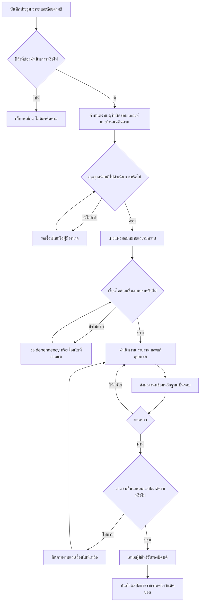
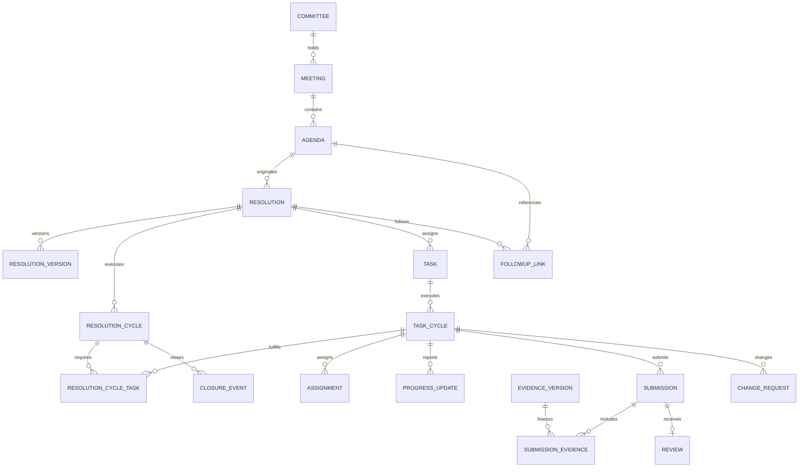

# PRD — POLUBU Smart meeting

**ระบบบริหารจัดการติดตามการดำเนินงานตามมติการประชุม**

| รายการ | รายละเอียด |
|---|---|
| เวอร์ชันเอกสาร | 0.1 — ฉบับวิเคราะห์เพื่อทบทวนและยืนยันก่อนพัฒนา |
| วันที่จัดทำ | 24 ตุลาคม 2569 (2026-10-24), Asia/Bangkok |
| บริบทที่ใช้ในต้นทาง | คณะรัฐศาสตร์ มหาวิทยาลัยอุบลราชธานี |
| ผู้ใช้หลัก | เลขานุการ ผู้รับผิดชอบงาน ผู้ตรวจผล ผู้มีอำนาจรับรอง และผู้บริหาร |
| แหล่งข้อมูลหลัก | [บทสนทนา requirement เบื้องต้น: ออกแบบระบบติดตามมติ](https://chatgpt.com/share/6adcd6dd-181c-83ec-aa7d-22000d20673e) |
| เจ้าของผลิตภัณฑ์ / ผู้รับรอง PRD | รอระบุชื่อและขอบเขตอำนาจ |
| สถานะ | ร่างข้อกำหนด ยังไม่ใช่นโยบายที่คณะรับรองหรือคำมั่นด้านกำหนดส่งและงบประมาณ |

## สารบัญ

- [1. ที่มา ขอบเขตการวิเคราะห์ และระดับความเชื่อมั่น](#section-01)
- [2. บทสรุปผลิตภัณฑ์](#section-02)
- [3. ผู้มีส่วนได้ส่วนเสียและสถานการณ์ใช้งาน](#section-03)
- [4. ขอบเขตและลำดับความสำคัญ](#section-04)
- [5. หลักการและกฎธุรกิจ](#section-05)
- [6. กระบวนงานหลัก](#section-06)
- [7. แบบจำลองสถานะและเงื่อนไขเปลี่ยนสถานะ](#section-07)
- [8. สิทธิและขอบเขตการเข้าถึง](#section-08)
- [9. ข้อกำหนดเชิงหน้าที่และเกณฑ์ตรวจรับ](#section-09)
- [10. แบบจำลองข้อมูลและพจนานุกรมข้อมูล](#section-10)
- [11. กติกากำหนดเวลาและปฏิทิน](#section-11)
- [12. การแจ้งเตือนและยกระดับ](#section-12)
- [13. Dashboard รายงาน และนิยามตัวชี้วัด](#section-13)
- [14. ประสบการณ์ใช้งานและรายการหน้าจอ](#section-14)
- [15. ข้อกำหนดคุณภาพระบบ (Non-functional Requirements)](#section-15)
- [16. แนวทางเทคโนโลยีและการเชื่อมต่อ](#section-16)
- [17. แผนพัฒนา นำร่อง และส่งมอบ](#section-17)
- [18. แผนตรวจรับและการเชื่อมโยงข้อกำหนด](#section-18)
- [19. ความเสี่ยงและมาตรการจัดการ](#section-19)
- [20. ประเด็นตัดสินใจและคำถามค้าง](#section-20)
- [21. Definition of Ready และ Definition of Done](#section-21)
- [22. อภิธานศัพท์](#section-22)
- [23. ประวัติเอกสาร](#section-23)

## 1. ที่มา ขอบเขตการวิเคราะห์ และระดับความเชื่อมั่น

ผู้ใช้ในบทสนทนาต้นทางร้องขอให้ออกแบบระบบบริหารจัดการติดตามการดำเนินงานตามมติการประชุม ส่วนคำตอบท้ายบทสนทนาเสนอชื่อ POLUBU Smart meeting บริบทคณะรัฐศาสตร์ กระบวนงาน สิทธิผู้ใช้ แบบข้อมูล ตัวชี้วัด และแผนพัฒนา 10 สัปดาห์ โดยระบุชัดว่าเป็น **ข้อเสนอการออกแบบ** ซึ่งอำนาจอนุมัติ เป้าหมายเวลา และเงื่อนไขปิดมติต้องยึดแนวปฏิบัติของคณะ

PRD นี้ขยายข้อเสนอดังกล่าวให้มีขอบเขต ฟังก์ชัน กฎธุรกิจ เกณฑ์ตรวจรับ และประเด็นตัดสินใจที่ทีมผลิตภัณฑ์และทีมพัฒนานำไปใช้ร่วมกันได้ ไม่ถือว่าข้อเสนอของผู้ช่วยในบทสนทนาได้รับอนุมัติจากผู้ใช้แล้วโดยอัตโนมัติ

การอ้างอิงต้นทางในเอกสารนี้ใช้คำตอบสุดท้ายของบทสนทนา รหัสข้อความ `5fbe50b9-64db-51b3-bdd2-bba9c006eb4c` และหมายเลขหัวข้อ 1–14 ในคำตอบนั้น เอกสาร Word 15 หน้าและหน้าจอจำลองที่ต้นทางกล่าวถึง **ยังไม่ได้เปิดตรวจเนื้อหาแยกต่างหาก** จึงไม่ใช้เป็นหลักฐานเพิ่มเติม

### 1.1 สัญลักษณ์ที่ใช้

| รหัส | ความหมาย | วิธีนำไปใช้ |
|---|---|---|
| U | ความต้องการที่ผู้ใช้ระบุโดยตรง | เป้าหมายหลักคือระบบติดตามการดำเนินงานตามมติ และการจัดทำ PRD อย่างละเอียด |
| S | รายละเอียดที่ปรากฏในข้อเสนอของต้นทาง | ใช้เป็นฐานออกแบบร่างนี้ แต่ยังต้องผ่านเจ้าของกระบวนงาน |
| E | ข้อกำหนดที่วิเคราะห์เพิ่มเพื่อให้พัฒนาและทดสอบได้ | ต้องทบทวน โดยเฉพาะสิทธิ ตัวเลขสมรรถนะ และนโยบายคำนวณ |
| Q | เรื่องที่ยังต้องตัดสินใจ | อ้างรหัสคำถามในหัวข้อ 20; ห้ามตีความช่องว่างเป็นการอนุมัติ |

คำว่า “ต้อง” ในเอกสารนี้หมายถึงเงื่อนไขตรวจรับของ **PRD ฉบับร่างที่เสนอ** เมื่อได้รับการรับรองแล้ว มิได้อ้างว่ามีนโยบายองค์กรดังกล่าวอยู่ก่อน เอกสารนี้ไม่กำหนดข้อสรุปด้านกฎหมายแทนหน่วยงานผู้รับผิดชอบ

### 1.2 หลักฐานต้นทางแบบย่อ

| แหล่ง | เนื้อหาที่ใช้ |
|---|---|
| S-01 / หัวข้อ 1, 3 | การประชุม → วาระ → มติ → งาน → หลักฐาน → ตรวจรับ → ปิดมติ |
| S-02 / หัวข้อ 4 | บทบาทร่วมกับขอบเขตข้อมูล และการแยกอำนาจทางธุรกิจออกจากผู้ดูแลระบบ |
| S-03 / หัวข้อ 5, 6 | โมดูล หน้ารายละเอียด และข้อมูลแบบฟอร์ม |
| S-04 / หัวข้อ 7, 8 | สถานะหลายมิติ กำหนดเดิม/ปัจจุบัน/ที่เสนอ มติทดแทน งานต่อเนื่อง และเปิดใหม่ |
| S-05 / หัวข้อ 9 | การแจ้งเตือน การยกระดับ และค่าตั้งต้นที่ต้องทดลอง |
| S-06 / หัวข้อ 10 | Dashboard ตัวชี้วัด วันตัดยอด และการแยกเวลาส่งกับเวลาตรวจ |
| S-07 / หัวข้อ 11 | กลุ่มข้อมูล แนวทางเทคโนโลยี สิทธิระดับข้อมูล ประวัติ และการสำรอง |
| S-08 / หัวข้อ 12, 13 | ตัวอย่างมติ ขอบเขตรุ่นแรก ระยะถัดไป แผนเวลา และกรณีรับมอบ |
| S-09 / หัวข้อ 14 | การประเมิน R2R ค่าฐาน และเป้าหมายตั้งต้น |

## 2. บทสรุปผลิตภัณฑ์

POLUBU Smart meeting เป็นระบบกลางสำหรับเปลี่ยนมติประชุมที่ต้องดำเนินการให้เป็นงานที่ติดตามและตรวจรับได้ ตั้งแต่ระบุเจ้าของงาน ผลส่งมอบ เกณฑ์สำเร็จ กำหนดเวลา และผู้ตรวจ ไปจนถึงเก็บหลักฐาน รับรองผล ปิดมติ และเตรียมวาระสืบเนื่องในการประชุมครั้งถัดไป

คำถามที่ระบบต้องตอบได้สำหรับทุกมติที่มีงาน ได้แก่ **ใครต้องทำอะไร ส่งเมื่อใด ใช้หลักฐานใด ใครรับรองผล และยังติดอยู่ขั้นตอนไหน** ผู้บริหารต้องดูภาพรวมแล้วลงไปตรวจมติ งาน และหลักฐานต้นทางได้ตามสิทธิ

### 2.1 ปัญหาที่ต้องตรวจสอบกับผู้ใช้จริง

ปัญหาต่อไปนี้อนุมานจากรูปแบบระบบในต้นทาง ยังไม่มีข้อมูลสัมภาษณ์หรือค่าฐานยืนยันขนาดปัญหา

| ปัญหาที่คาดว่าพบ (E) | ผลกระทบ | ความสามารถที่ตอบโจทย์ |
|---|---|---|
| มติกระจายตามรายงานประชุมและช่องทางติดตาม | ค้นสถานะล่าสุดยากและติดตามซ้ำ | ทะเบียนมติรหัสถาวรและการเชื่อมวาระสืบเนื่อง |
| เจ้าภาพ ผลงาน หรือเกณฑ์สำเร็จไม่ชัด | งานตกหล่นและผู้ทำกับผู้ตรวจเข้าใจไม่ตรงกัน | ตรวจข้อมูลบังคับก่อนมอบหมาย |
| สถานะจากการรายงานไม่ตรงกับหลักฐาน | ปิดงานก่อนสำเร็จจริง | แยกความก้าวหน้า การส่งตรวจ และการรับรอง |
| เปลี่ยนกำหนดแล้วไม่เห็นประวัติเดิม | KPI และความรับผิดชอบคลาดเคลื่อน | กำหนดเดิมที่คงไว้และประวัติอนุมัติ |
| รวมความล่าช้าผู้ทำกับผู้ตรวจ | ระบุจุดติดขัดไม่ตรง | เก็บเวลาส่งและเวลาตัดสินใจแยกกัน |
| เลขานุการต้องรวบรวมรายงานด้วยตนเอง | ใช้เวลามากและตัวเลขไม่สอดคล้องกัน | รายงานจากข้อมูลเดียวพร้อมวันตัดยอด |

### 2.2 เป้าหมายผลิตภัณฑ์

1. ทำให้มติที่ต้องดำเนินการมีเจ้าภาพ ผลส่งมอบ กำหนดติดตาม และผู้รับรองครบถ้วน
2. ทำให้การดำเนินงานและหลักฐานตรวจสอบย้อนกลับได้ตลอดวงจร
3. ลดงานรวบรวมและทวงถามซ้ำของเลขานุการ โดยยังระบุผู้ตัดสินใจได้ชัด
4. ชี้งานค้าง อุปสรรค และคอขวดระหว่างทำงาน ตรวจผล และปิดมติ
5. ใช้ตัวชี้วัดที่นิยามตรงกันและไม่ทำให้ประวัติค้างหายจากการเลื่อนกำหนด
6. รองรับการนำร่องหนึ่งคณะกรรมการแล้วขยาย โดยไม่ต้องเปลี่ยนรหัสหรือทำสำเนามติเดิม

### 2.3 ผลลัพธ์และเป้าหมายตั้งต้น

| เป้าหมาย | วิธีวัด | ค่าเป้าหมาย / สถานะ |
|---|---|---|
| ข้อมูลก่อนมอบหมายครบ | งานเผยแพร่ที่ผ่านข้อมูลบังคับ ÷ งานเผยแพร่ทั้งหมด | 100%; S-09; เป็นเงื่อนไขระบบที่เสนอ |
| งานผ่านตรวจมีหลักฐานและผู้รับรอง | งานตรวจรับที่มีข้อมูลดังกล่าวครบ ÷ งานตรวจรับทั้งหมด | 100%; S-09 |
| รับทราบงานรวดเร็ว | การมอบหมายที่รับทราบภายใน 2 วันทำการ ÷ การมอบหมายที่ครบหน้าต่างประเมิน ตามนิยาม KPI-06 | อย่างน้อย 95%; S-09; รอยืนยันปฏิทินและเป้าหมาย |
| ลดเวลารวบรวมรายงาน | เปรียบเทียบเวลาจริงก่อนและหลังใช้กับรายงานขอบเขตเทียบกัน | ลดอย่างน้อย 50%; S-09; ต้องมี baseline |
| เห็นสถานะงานครบ | งานที่มีเจ้าของ รอบติดตาม และสถานะล่าสุดตามเกณฑ์ | เก็บ baseline ก่อนกำหนดเป้าหมายเพิ่มเติม |

ห้ามรายงานว่าบรรลุเป้าหมายจนมีข้อมูลจริง การวัดรับทราบต้องรวมการมอบหมายที่ครบเวลารอแล้วแต่ยังไม่รับทราบไว้ในตัวหาร แยกที่ยังไม่ครบเวลารอ และเปิดเผยการมอบหมายที่ถูกแทนก่อนหน้าต่างประเมินตาม KPI-06

## 3. ผู้มีส่วนได้ส่วนเสียและสถานการณ์ใช้งาน

| กลุ่ม | งานที่ต้องทำให้สำเร็จ | สิ่งที่ต้องเห็นก่อน | ผลสำเร็จของการใช้งาน |
|---|---|---|---|
| เลขานุการ/ผู้ช่วย | เปลี่ยนมติเป็นงานและจัดรายงานประชุมถัดไป | มติข้อมูลไม่ครบ งานยังไม่รับทราบ คำขอค้าง | แจ้งมอบหมายได้ครบและออกรายงานที่ตรวจสอบได้ |
| ผู้รับผิดชอบหลัก | ทำงาน ส่งผล ขอความช่วยเหลือ | งานของตน กำหนด เกณฑ์ตรวจ หลักฐานที่ต้องส่ง | ส่งผลงานได้และทราบผลตรวจหรือสิ่งที่ต้องแก้ |
| ผู้ร่วมดำเนินการ | ช่วยทำและบันทึกหลักฐาน | งานที่ได้รับสิทธิและส่วนที่รับผิดชอบ | เพิ่มข้อมูลร่วมได้โดยไม่แก้เงื่อนไขหลัก |
| ผู้ตรวจผล | ตัดสินผลงานตามเกณฑ์ | คิวส่งตรวจ รุ่นผลงาน เกณฑ์ และประวัติ | รับรอง/ส่งกลับพร้อมเหตุผลที่ตรวจย้อนหลังได้ |
| ผู้มีอำนาจรับรองปิด | ยืนยันว่ามติครบเงื่อนไข | งานจำเป็น เงื่อนไขระดับมติ และข้อยกเว้น | ปิดหรือส่งกลับได้ภายในขอบเขตอำนาจ |
| หัวหน้าหน่วยงาน | จัดภาระและแก้อุปสรรค | งานในหน่วยงาน ภาระงาน เรื่องขอช่วย | ตัดสินใจหรือส่งต่อได้โดยไม่ต้องไล่อ่านทุกมติ |
| ผู้บริหาร/ประธาน | ติดตามผลและตัดสินใจเรื่องสำคัญ | งานเสี่ยง ผลกระทบ คอขวด และแนวโน้ม | อธิบายตัวเลขและเข้าถึงหลักฐานที่มีสิทธิได้ |
| กรรมการ/ผู้ตรวจสอบ | อ่านผลและตรวจย้อนหลัง | รายงานตามวันตัดยอดและประวัติ | เห็นหลักฐานตรงกับผลรับรองในช่วงนั้น |
| ผู้ดูแลระบบ | ดูแลบัญชี การตั้งค่า และความพร้อม | สถานะบริการ งานแจ้งเตือน และปัญหาทางเทคนิค | แก้ปัญหาระบบได้โดยไม่มีอำนาจรับรองทางธุรกิจอัตโนมัติ |

ผู้ใช้หนึ่งคนมีหลายบทบาทได้ แต่สิทธิของแต่ละกิจกรรมต้องตรวจจากบทบาท ขอบเขต ช่วงเวลาที่มีผล และความเกี่ยวข้องกับรายการนั้น ไม่ใช้เพียงชื่อเรียกตำแหน่ง

## 4. ขอบเขตและลำดับความสำคัญ

### 4.1 เกณฑ์จัดลำดับ

- **P0 / MVP:** จำเป็นต่อวงจรบันทึก–มอบหมาย–รายงาน–ตรวจรับ–ปิด–รายงาน และการควบคุมข้อมูล รุ่นนำร่องต้องทำได้ครบ
- **P1:** เพิ่มประสิทธิภาพหรือการเชื่อมต่อ หลังวงจรหลักมีข้อมูลและผ่านการทดลอง
- **P2:** ความสามารถขั้นสูงที่ต้องมีหลักฐานความคุ้มค่าและข้อกำหนดเพิ่ม

### 4.2 ขอบเขต MVP ที่เสนอ

1. ผู้ใช้ หน่วยงาน คณะกรรมการ และสิทธิรายขอบเขต
2. ทะเบียนประชุม วาระ เอกสารต้นทาง และรุ่นรายงานประชุม
3. ทะเบียนมติรหัสถาวร ประเภท เกณฑ์ปิด การอนุญาตเริ่ม และการเชื่อมมติ
4. หลายงานต่อหนึ่งมติ เจ้าของหลักหนึ่งคน ผู้ร่วมงาน ผู้ตรวจ และเงื่อนไขก่อนเริ่ม
5. รับทราบงาน ความก้าวหน้า อุปสรรค รอบรายงาน และหลักฐาน
6. ส่งผลหลายรอบ ตรวจรับ/ส่งกลับ และปิดมติโดยผู้มีสิทธิ
7. คำขอเปลี่ยนกำหนด เจ้าของ ขอบเขต ยกเลิก และเปิดใหม่ พร้อมประวัติ
8. มติต่อเนื่องและงานตามรอบที่สร้างด้วยผู้ใช้; ยังไม่ต้องมีตัวสร้างรอบอัตโนมัติ
9. รายงานติดตามมติ รายงานงานค้าง คิวตรวจ Dashboard และรายงานตามวันตัดยอด
10. การแจ้งเตือนในระบบ การตั้งรอบ และบันทึกการส่ง; ช่องทางภายนอกขึ้นกับ Q-05
11. การควบคุมไฟล์ ประวัติกิจกรรม การสำรองและทดสอบกู้คืนทั้งข้อมูลและหลักฐาน
12. เครื่องมือหรือขั้นตอนนำเข้าข้อมูลนำร่องที่ผ่านการตรวจ ไม่จำเป็นต้องมีหน้าจอนำเข้าทั่วไปใน MVP

### 4.3 ระยะถัดไป

| ระยะ | รายการ | เงื่อนไขก่อนเริ่ม |
|---|---|---|
| P1 | เชื่อมบัญชีมหาวิทยาลัย | ยืนยันผู้ให้บริการ รูปแบบบัญชี และสิทธิที่อนุมัติ |
| P1 | เชื่อม e-Doc ผ่าน API | มี API สิทธิใช้งาน และขอบเขตเอกสารจริง |
| P1 | ส่งข้อมูลสรุปไป POLUBU Hub Smart Dashboard | ตกลงนิยาม KPI สิทธิ และวันตัดยอดร่วมกัน |
| P1 | สร้างงานตามรอบอัตโนมัติ | รอบงาน วันหยุด และกรณีหยุดรอบนิ่งแล้ว |
| P1 | การประเมินผลลัพธ์ระยะยาวโดยเฉพาะ | ระบุผลลัพธ์ ผู้ประเมิน และรอบประเมิน; MVP สร้างงานติดตามแยกได้ |
| P1 | เครื่องมือนำเข้าแบบบริการตนเอง/การย้ายข้อมูลจำนวนมาก | ทราบคุณภาพและรูปแบบข้อมูลเดิม |
| P2 | AI ช่วยสกัดร่างมติหรือสรุปงานค้าง | ต้องอ้างต้นทาง เว้นช่องที่ไม่ทราบ และมีคนยืนยันก่อนใช้ |

### 4.4 นอกขอบเขตใน PRD รุ่นนี้ (E)

- ระบบประชุมวิดีโอ การถอดเสียงสด หรือแพลตฟอร์มจัดประชุมครบวงจร
- ระบบงบประมาณ การเงิน บุคลากร หรือสารบรรณทดแทนระบบกลาง
- การลงนามอิเล็กทรอนิกส์ที่มีข้อผูกพันหรือการรับรองตามกฎหมายเฉพาะโดยยังไม่วิเคราะห์
- การเผยแพร่มติหรือหลักฐานต่อสาธารณะโดยอัตโนมัติ
- AI ที่อนุมัติเลื่อนกำหนด ตรวจรับ ปิดมติ หรือมอบหมายแทนผู้มีอำนาจ
- Native mobile app และการแก้ไขข้อมูลแบบ offline; MVP เป็นเว็บที่ใช้งานบนมือถือได้

## 5. หลักการและกฎธุรกิจ

| รหัส | กฎ | ที่มา |
|---|---|---|
| BR-01 | หนึ่งมติมีรหัสถาวร การติดตามในประชุมครั้งใหม่ใช้การเชื่อม ไม่สร้างมติซ้ำ | S-01 |
| BR-02 | หนึ่งงานมีผู้รับผิดชอบหลักที่มีผล ณ เวลาเดียวกันเพียงหนึ่งคน และมีผู้ร่วมงานได้หลายคน | S-01 |
| BR-03 | ห้ามเผยแพร่มอบหมายหากข้อมูลบังคับ เกณฑ์ตรวจ ผู้ตรวจ และเงื่อนไขเวลาไม่ครบ | S-01 |
| BR-04 | ความก้าวหน้า 100% ไม่เท่ากับตรวจรับหรือปิดมติ | S-01, S-04 |
| BR-05 | สถานะรับรองรายงานประชุมกับการอนุญาตนำมติไปดำเนินการเป็นคนละมิติ | S-01, S-04 |
| BR-06 | กำหนดเดิม กำหนดที่อนุมัติปัจจุบัน และกำหนดที่เสนอขอ ต้องเก็บแยก; คำขอค้างไม่มีผลต่อกำหนดใช้งาน | S-04 |
| BR-07 | ผลตรวจต้องอ้างรอบส่ง รุ่นเกณฑ์ และรุ่นหลักฐานแน่นอน; ห้ามแทนที่ไฟล์เดิมของรอบที่รับรอง | S-03; รุ่นเกณฑ์เพิ่มเป็น E |
| BR-08 | ปิดมติได้เมื่อทุกงานจำเป็นผ่านตรวจ เงื่อนไขระดับมติครบ และผู้รับรองมีสิทธิ ณ เวลาตัดสินใจ | S-01 |
| BR-09 | งานจำเป็นที่ยกเลิกไม่ถือว่าผ่าน; ต้องมีการอนุมัติปรับเกณฑ์/ขอบเขต หรือยุติมติให้ถูกประเภท | E จาก S-01, S-04 |
| BR-10 | มติรับทราบอย่างเดียวไม่มีงานและไม่เข้าตัวหารมติที่ต้องดำเนินการ; รับทราบพร้อมมอบหมายต้องสร้างงาน | S-01, S-04 |
| BR-11 | ยกเลิกหรือทดแทนไม่ถือเป็นความสำเร็จ และไม่ลบหลักฐานหรือประวัติ | S-04, S-06 |
| BR-12 | เปลี่ยนเจ้าของไม่รีเซ็ตกำหนด ความก้าวหน้า รอบส่ง หรือประวัติเดิม | S-04 |
| BR-13 | การเปิดใหม่สร้างรอบดำเนินการใหม่ อ้างรอบเดิม โดยคงผลและวันปิดเดิม | S-04; รูปแบบรอบเพิ่มเป็น E |
| BR-14 | สิทธิทางธุรกิจไม่เกิดจากการเป็นผู้ดูแลระบบ ผู้ตรวจตนเองถูกปฏิเสธโดยปริยาย | S-02 |
| BR-15 | รายงานทุกฉบับต้องมีวันตัดยอด ตัวกรอง หน่วยนับ นิยามสูตร และข้อมูลเพียงพอให้ตรวจที่มา | S-06; รุ่นสูตรเพิ่มเป็น E |
| BR-16 | เวลาแจ้งสำเร็จ เวลาเผยแพร่มอบหมาย และเวลารับทราบต้องแยกกัน | S-01 |
| BR-17 | มติต่อเนื่องไม่ปิดอัตโนมัติเพราะงานรอบหนึ่งผ่านตรวจ | S-04 |
| BR-18 | การเปลี่ยนสิทธิหรือเพิกถอนต้องมีผลกับ API ไฟล์ รายงาน และการกระทำที่ยังไม่ commit | E จาก S-02, S-07 |

## 6. กระบวนงานหลัก

### 6.1 สถานการณ์ปกติ

1. เลขานุการเลือกคณะกรรมการ สร้างการประชุม วาระ และแนบต้นทาง
2. บันทึกมติและประเภท พร้อมเกณฑ์ปิดและผู้มีอำนาจรับรอง
3. ถ้ามีงาน กำหนดอย่างน้อยเจ้าของหลัก สิ่งที่ต้องทำ ผลส่งมอบ เกณฑ์ตรวจ เวลา หลักฐาน และผู้ตรวจ/ผู้รับรอง
4. ตรวจการอนุญาตนำมติไปดำเนินการและความครบถ้วน; ผู้มีสิทธิเผยแพร่มอบหมายได้ โดยงานที่มี dependency ยังแสดงเงื่อนไขรอเริ่ม
5. เจ้าของกดรับทราบ เมื่อ dependency/เงื่อนไขก่อนเริ่มครบจึงเริ่มดำเนินการและรายงานผล/อุปสรรคตามรอบ
6. เจ้าของส่งรอบผลงาน ระบบตรึงชุดเกณฑ์และหลักฐานที่ส่งให้ตรวจ
7. ผู้ตรวจรับรองหรือส่งกลับพร้อมรายการแก้ไข; ผู้ทำส่งรอบใหม่เมื่อแก้แล้ว
8. เมื่อทุกเงื่อนไขครบ ผู้มีสิทธิรับรองปิดมติ; ระบบไม่ปิดแทนเพียงเพราะงานย่อยครบ
9. เลขานุการออกรายงานตามวันตัดยอดหรือเชื่อมมติเดิมเข้าวาระสืบเนื่อง

### 6.2 ทางเลือกและกรณีสำคัญ

| กรณี | พฤติกรรมที่ต้องเกิด |
|---|---|
| รายงานประชุมยังไม่รับรอง | งานเริ่มได้เฉพาะมีการอนุญาตเริ่มแยกพร้อมหลักฐาน; ห้ามถือว่าเริ่มได้ทุกมติ |
| ไม่ทราบวันส่งผลงาน | ต้องมีเหตุผลและวันรายงานครั้งถัดไป; แสดงว่าไม่มีวันส่ง ห้ามแทนด้วยวันรายงาน |
| ผู้รับผิดชอบไม่ใช่ผู้ที่ควรทำ | ส่งคำขอแก้การมอบหมาย ไม่เปลี่ยนเจ้าของเอง; เจ้าของเดิมยังคงมีผลจนอนุมัติ |
| มีอุปสรรค | บันทึกสาเหตุ ผู้ช่วย สิ่งที่ต้องตัดสินใจ และวันทบทวน โดยไม่เปลี่ยนสถานะเป็นสำเร็จ |
| ขอขยายกำหนด | วันเสนอใหม่ยังไม่มีผลจนอนุมัติ; แจ้งผลทั้งเจ้าของและผู้ติดตาม |
| เปลี่ยนถ้อยคำหลังยืนยัน | สร้างรุ่นและวิเคราะห์ผลกระทบกับงาน/เกณฑ์ก่อนมีผล |
| มติใหม่ทดแทนบางส่วน | เชื่อมมติใหม่และระบุผลของงานเดิมแต่ละงาน ไม่ยุติงานทั้งหมดอัตโนมัติ |
| งานต่อเนื่อง | สร้างงานรายรอบที่มีวันส่งและผลตรวจแยก แสดงรอบถัดไปของมติแม่ |
| ต้องวัดผลระยะยาว | ตรวจรับผลส่งมอบตามขอบเขตเดิม แล้วสร้างงาน/รอบประเมินผลแยก |
| เปิดมติที่ปิดแล้ว | บันทึกเหตุผลและผู้อนุญาต สร้างรอบใหม่ และรักษาผลรายงานรอบเดิม |

## 7. แบบจำลองสถานะและเงื่อนไขเปลี่ยนสถานะ

### 7.1 สถานะหลายมิติ

| มิติ | ค่าที่ใช้ในร่าง | ข้อกำหนด |
|---|---|---|
| รายงานประชุม | ร่าง / ตรวจแล้ว / รับรองแล้ว / มีฉบับแก้ไข | แสดงฉบับที่มีผลและฉบับร่างแก้ไขแยกกัน; การทำฉบับแก้ไขไม่ลบฉบับรับรอง |
| อนุญาตเริ่ม | ยังไม่อนุญาต / อนุญาตแล้ว / ระงับหรือถอน | เก็บผู้ตัดสินใจ เหตุผล เงื่อนไข เวลา และหลักฐาน |
| งาน | ร่าง / มอบหมายแล้ว / กำลังดำเนินการ / ส่งตรวจ / ให้แก้ไข / ตรวจรับแล้ว / ยกเลิก | บันทึกเวลาจากเหตุการณ์จริง ห้ามแก้ค่าโดยข้าม transition |
| มติ | ร่างทะเบียน / ไม่ต้องติดตาม / เปิดติดตาม / รอรับรองผล / ปิดมติ / ยุติจากยกเลิกหรือทดแทน | การยุติแยกจากปิดสำเร็จ; มติต่อเนื่องยังเปิดแม้รอบล่าสุดเสร็จ |
| เวลา | ไม่มีกำหนดส่ง / ยังไม่ถึง / ใกล้ครบ / เกินกำหนด / รอตรวจเกินเกณฑ์ | เป็นค่าคำนวณจากเวลาและรอบ ไม่ใช่สถานะงานที่ทับกัน |
| อุปสรรค | ไม่มี / มีประเด็นเปิด / แก้แล้ว | มีรายละเอียดผู้ช่วยและวันทบทวน หลายประเด็นต่อหนึ่งงานได้ |
| ผลระยะยาว | ยังไม่ถึงรอบ / บรรลุ / บรรลุบางส่วน / ไม่บรรลุ / ยังประเมินไม่ได้ | แยกจากการรับรองผลส่งมอบ; โมดูลเฉพาะอยู่ P1 |

### 7.2 การเปลี่ยนสถานะงาน

| จาก → ไป | ผู้ดำเนินการ | เงื่อนไขก่อนเปลี่ยน | เหตุการณ์/ผลที่ต้องบันทึก |
|---|---|---|---|
| ร่าง → มอบหมายแล้ว | ผู้มีสิทธิมอบหมาย | ข้อมูลครบและมติมีการอนุญาตนำไปดำเนินการ; dependency ค้างได้แต่ยังเริ่มงานไม่ได้ | รุ่นการมอบหมาย เวลาเผยแพร่ และสร้างรายการแจ้งเตือน |
| มอบหมายแล้ว → มอบหมายแล้ว (รับทราบ) | เจ้าของหลัก | เป็นเจ้าของรุ่นการมอบหมายปัจจุบัน | `acknowledged_at`; ไม่ถือว่าเริ่มทำจริงและไม่เปลี่ยนสถานะ |
| มอบหมายแล้ว → กำลังดำเนินการ | เจ้าของหลัก | รับทราบแล้ว การอนุญาตและสิทธิยังมีผล และ dependency/เงื่อนไขก่อนเริ่มผ่าน | `started_at` เมื่อกดเริ่ม; ถ้ารายงานครั้งแรก ให้ยืนยันเริ่มก่อนบันทึก |
| กำลังดำเนินการ → ส่งตรวจ | เจ้าของหลัก | ผลส่งมอบครบ หลักฐานบังคับครบ ไม่ระงับ และ dependency/เงื่อนไขยังถูกต้อง | สร้าง submission ใหม่และตรึงรุ่นเกณฑ์/หลักฐาน |
| ส่งตรวจ → ให้แก้ไข | ผู้ตรวจที่มีอำนาจ | รอบยังรอตรวจและผู้ตรวจไม่ขัดผลประโยชน์ | ผลตรวจ เหตุผล รายการแก้ไข เวลา และผู้ตรวจ |
| ให้แก้ไข → ส่งตรวจ | เจ้าของหลัก | แก้ตามรายการและส่งหลักฐานรุ่นใหม่ครบ | รอบส่งใหม่ ไม่เขียนทับผลตรวจเก่า |
| ส่งตรวจ → ตรวจรับแล้ว | ผู้ตรวจ/ผู้รับรองตามอำนาจ | ผ่านทุกเกณฑ์บังคับ หลักฐานตรงรอบ และสิทธิถูกต้อง | ผลตรวจผ่านและ `accepted_at` ของรอบ |
| มอบหมายแล้ว/กำลังดำเนินการ/ให้แก้ไข → ยกเลิก | ผู้มีสิทธิอนุมัติคำขอ | เหตุผลและผลกระทบผ่านพิจารณา | วันมีผล ผู้อนุมัติ เหตุผล และประเภทการยุติ |
| ส่งตรวจ → ยกเลิก | ผู้มีสิทธิอนุมัติคำขอ | ยุติรอบตรวจที่ค้างในธุรกรรมเดียว | รอบตรวจเป็น withdrawn พร้อมเหตุผล; ไม่สร้างผลผ่าน/ไม่ผ่านเทียม |
| ตรวจรับแล้ว/ยกเลิก → เปิดรอบใหม่ | ผู้มีสิทธิเปิดใหม่ | อนุมัติเหตุผลและขอบเขตรอบใหม่ | รอบเก่ายังคงสถานะเดิม; รอบใหม่เริ่มร่างและตรวจเงื่อนไขอีกครั้ง |

ข้อเสนอ MVP: ยังไม่มีการถอน submission ด้วยเจ้าของโดยตรง หากส่งผิดให้ผู้ตรวจส่งกลับพร้อมเหตุผล; การถอนจากการยุติเป็นกิจกรรมของผู้มีอำนาจ การอนุญาตให้เจ้าของถอนเองเป็น Q-10

การระงับ/ถอนอนุญาตเริ่มเป็น flag ควบคุม ไม่เปลี่ยนงานที่เคยตรวจรับให้กลับเป็นร่าง อนุญาตให้อ่านและบันทึกเหตุจำเป็น แต่ปิดกั้นการเผยแพร่ ส่งตรวจ ตรวจรับ และปิดมติใหม่จนมีการอนุญาต หรือมีคำสั่งยุติที่ถูกต้อง (E; Q-02)

### 7.3 การเปลี่ยนสถานะมติ

| จาก → ไป | เงื่อนไข |
|---|---|
| ร่างทะเบียน → ไม่ต้องติดตาม | ยืนยันว่าเป็นรับทราบอย่างเดียว ไม่มีสิ่งที่ต้องส่งมอบ |
| ร่างทะเบียน/ไม่ต้องติดตาม → เปิดติดตาม | ยืนยันว่ามีงานและบันทึกรุ่น/เหตุผล; ต้องมีงานก่อนเผยแพร่มอบหมาย |
| เปิดติดตาม → รอรับรองผล | งานจำเป็นผ่านตรวจทั้งหมด เกณฑ์ระดับมติครบ และไม่มีคำขอที่กระทบการปิดค้าง |
| รอรับรองผล → เปิดติดตาม | ผู้รับรองระบุเงื่อนไขที่ยังไม่ครบ หรือมีการเปลี่ยนงาน/เกณฑ์ที่มีผล |
| รอรับรองผล → ปิดมติ | ผู้มีอำนาจรับรอง พร้อมตรวจเงื่อนไขซ้ำภายในธุรกรรมเดียว |
| เปิดติดตาม/รอรับรองผล → ยุติ | มีคำสั่งยกเลิกหรือทดแทน และกำหนดชะตาของงานเดิมครบทุกงาน |
| ปิดมติ/ยุติ → เปิดรอบใหม่ | ได้รับอนุญาตและสร้างรอบดำเนินการใหม่; ไม่ลบผลปิดเดิม |

ข้อเสนอ E: งานไม่จำเป็นที่ยังค้างต้องระบุว่าจะทำต่อ ย้ายไปมติอื่น หรือยุติโดยใครก่อนปิดมติ ไม่ปล่อยงานกำพร้า; สถานะ “ไม่จำเป็น” ต้องมีเหตุผลและผู้อนุมัติ ไม่ให้ผู้ทำเปลี่ยนเอง

หากเปิดงานจำเป็นขึ้นใหม่ภายใต้มติที่ปิดแล้ว ต้องอนุมัติเปิดรอบมติใหม่พร้อมกันหรือมีมติใหม่ให้อำนาจและรับผิดชอบงานนั้น ห้ามปล่อยให้มติแสดงปิดสำเร็จในรอบปัจจุบันขณะที่งานจำเป็นของรอบเดียวกันยังเปิดอยู่

## 8. สิทธิและขอบเขตการเข้าถึง

### 8.1 หลักการตรวจสิทธิ

ใช้บทบาทร่วมกับ scope ได้แก่ คณะกรรมการ หน่วยงาน มติ และงานที่ได้รับมอบหมาย รวมช่วงเวลาสิทธิและระดับการเข้าถึงเอกสาร การอ่านข้อมูล การแก้ไข การส่งออก และการตัดสินใจเป็นสิทธิคนละรายการ

ข้อเสนอ E: หากสิทธิขัดกัน ให้ข้อจำกัดเฉพาะรายการและข้อห้ามตรวจตนเองมีลำดับเหนือสิทธิทั่วไป การเป็นหัวหน้าหน่วยงานหรือประธานไม่ทำให้เห็นข้อมูลทั้งหมดนอก scope โดยปริยาย

### 8.2 ตารางสิทธิตั้งต้น

คำว่า “ตามมอบหมาย” หมายถึงต้องมีสิทธิของกิจกรรมนั้นและ scope ของรายการ ไม่อนุมานจากตำแหน่ง

| กิจกรรม | เลขานุการ | เจ้าของ/ผู้ร่วม | หัวหน้าหน่วยงาน | ผู้ตรวจ/ผู้รับรอง | ผู้บริหาร/กรรมการ | ผู้ดูแลระบบ |
|---|---|---|---|---|---|---|
| อ่านข้อมูล | scope ที่ดูแล | รายการที่เกี่ยวข้อง | scope หน่วยงาน | รายการที่มอบหมาย | scope ที่อนุญาต | เฉพาะสิทธิอ่านแยก |
| สร้างประชุม วาระ มติ | ได้ตาม scope | ไม่ได้ | ตามมอบหมาย | ตามมอบหมาย | ตามมอบหมาย | ไม่ได้โดยตำแหน่ง |
| ยืนยันถ้อยคำ/อนุญาตเริ่ม | ตามมอบหมาย | ไม่ได้ | ตามมอบหมาย | ตามมอบหมาย | ตามมอบหมาย | ไม่ได้โดยตำแหน่ง |
| สร้าง/เผยแพร่งาน | ได้ตามอำนาจ | ไม่ได้ | ตามมอบหมาย | ตามมอบหมาย | ตามมอบหมาย | ไม่ได้โดยตำแหน่ง |
| รับทราบงาน | ไม่แทนเจ้าของ | เจ้าของหลักเท่านั้น | ไม่แทนเจ้าของ | ไม่แทนเจ้าของ | ไม่แทนเจ้าของ | ไม่ได้ |
| รายงาน/แนบหลักฐาน | ตามสิทธิสนับสนุน | ได้ในงานที่เกี่ยวข้อง | ตามมอบหมาย | ไม่แก้ชุดที่ส่งตรวจ | อ่านตาม scope | ไม่ได้โดยตำแหน่ง |
| ส่งผลงานให้ตรวจ | ไม่แทนเจ้าของ | เจ้าของหลัก; ผู้ร่วมยังไม่ส่งแทนใน MVP | ตามการมอบหมายเจ้าของ | ไม่ส่งแทนเจ้าของ | ไม่ได้โดยตำแหน่ง | ไม่ได้ |
| ขอเปลี่ยนกำหนด/เจ้าของ | ได้ตาม scope | เจ้าของหลัก | ได้ตาม scope | ตามมอบหมาย | ตามมอบหมาย | ไม่ได้ |
| อนุมัติเปลี่ยนแปลง | ตามอำนาจเฉพาะ | ไม่อนุมัติคำขอตนเองโดยปริยาย | ตามอำนาจ | ตามอำนาจ | ตามอำนาจ | ไม่ได้โดยตำแหน่ง |
| ตรวจรับงาน | ตามมอบหมาย | ห้ามตรวจผลงานตนเอง | ตามมอบหมาย | ได้ตาม scope | ตามมอบหมาย | ไม่ได้โดยตำแหน่ง |
| ปิด/ยุติ/เปิดมติใหม่ | ตามอำนาจเฉพาะ | ไม่ได้โดยตำแหน่ง | ตามอำนาจเฉพาะ | ตามอำนาจเฉพาะ | ตามอำนาจเฉพาะ | ไม่ได้โดยตำแหน่ง |
| ส่งออกรายงาน | ต้องมีสิทธิ export | ต้องมีสิทธิ export | ต้องมีสิทธิ export | ต้องมีสิทธิ export | ต้องมีสิทธิ export | ไม่ได้โดยตำแหน่ง |
| จัดผู้ใช้และค่าระบบ | ตามมอบหมายบางค่า | ไม่ได้ | ไม่ได้โดยตำแหน่ง | ไม่ได้ | ไม่ได้โดยตำแหน่ง | ได้ตามหน้าที่ |

### 8.3 การควบคุมที่ต้องตรวจรับ

- ตรวจสิทธิที่ฝั่งบริการทุกครั้ง รวม URL ที่คัดลอกมา API และการดาวน์โหลดไฟล์; การซ่อนปุ่มอย่างเดียวไม่เพียงพอ
- รายงานและการค้นหาต้องไม่เปิดเผยชื่อมติ จำนวนรายการ หรือ metadata ที่ผู้ใช้ไม่มีสิทธิ
- ผู้ตรวจต้องไม่เป็นหรือเคยเป็นเจ้าของ/ผู้ร่วมที่รับผิดชอบผลงานในรอบนั้นตามกติกาที่รับรอง; การเปลี่ยนบทบาทภายหลังต้องไม่ล้างประวัติเพื่อหลบข้อห้าม การแก้ metadata ทางธุรการอย่างเดียวไม่ถือว่าเป็นผู้ทำผลงาน
- ข้อยกเว้นตรวจตนเอง หากองค์กรต้องการ ต้องกำหนดนโยบาย ผู้อนุมัติ และ audit ก่อนเปิดใช้; MVP ปฏิเสธโดยปริยาย
- ปิดบัญชีและเพิกถอนสิทธิทันทีโดยไม่รอโอนงาน บัญชีไม่ถูกลบออกจากประวัติ งาน/คิวตรวจที่ขาดผู้ดูแลเข้าคิวให้ผู้มีอำนาจมอบหมายใหม่
- ไฟล์รับสิทธิจากรายการต้นทางและอาจจำกัดเพิ่มได้ แต่ห้ามให้ไฟล์เปิดกว้างกว่ามติ/งานโดยไม่อนุมัติ
- การเปลี่ยนสิทธิผู้ใช้ต้องบันทึกผู้ให้สิทธิ scope วันเริ่ม วันสิ้นสุด และเหตุผล; ห้ามใช้สิทธิ admin เพื่ออนุมัติทางธุรกิจแทนกัน
- การให้สิทธิตรวจรับ/อนุมัติ/ปิดมติต้องมีผู้มีอำนาจมอบหมายทางธุรกิจรับรองแยก ผู้ดูแลทางเทคนิคเพิ่มสิทธิเหล่านี้ให้ตนเองโดยลำพังไม่ได้
- ผู้มีสิทธิงานหนึ่งเห็นบริบทมติแม่เท่าที่ได้รับอนุญาต การเปิดรายการแม่ไม่ให้สิทธิอ่านงานพี่น้องหรือหลักฐานทั้งหมดโดยอัตโนมัติ ต้องจัดบริบทขั้นต่ำที่เพียงพอต่อการทำงานอย่างมีอำนาจ

## 9. ข้อกำหนดเชิงหน้าที่และเกณฑ์ตรวจรับ

เกณฑ์ในหัวข้อนี้ใช้เป็น acceptance criteria ขั้นต่ำ รายละเอียด UI และสัญญา API จัดทำต่อจาก PRD หลังยืนยัน Q ที่เกี่ยวข้อง

### FR-01 ผู้ใช้ หน่วยงาน และสิทธิ — P0

**เรื่องราวผู้ใช้:** ผู้ดูแลต้องกำหนดว่าใครเข้าระบบและทำอะไรในขอบเขตใด โดยไม่รวมอำนาจอนุมัติมติไว้กับงานดูแลระบบ (S-02, S-07; Q-01, Q-04)

- สร้าง/นำเข้าบัญชี เชื่อมหน่วยงาน ให้หลายบทบาทพร้อมช่วงเวลามีผล และปิดใช้งานได้
- รองรับวิธีพิสูจน์ตัวตนที่องค์กรยืนยัน; บัญชีมหาวิทยาลัยอยู่ P1 หากยังไม่มี integration พร้อม
- **AC:** ผู้มีบทบาทเดียวกันแต่ต่าง scope อ่านและแก้ไขเฉพาะข้อมูลตนเองได้
- **AC:** ถอนสิทธิแล้วคำขอครั้งถัดไปถูกปฏิเสธทั้ง API ไฟล์ และ export; ประวัติกิจกรรมเดิมยังอ่านชื่อผู้กระทำได้
- **AC:** ผู้ดูแลที่ไม่มีสิทธิธุรกิจตรวจรับหรือปิดมติไม่ได้

### FR-02 คณะกรรมการ การประชุม วาระ และเอกสาร — P0

**เรื่องราวผู้ใช้:** เลขานุการต้องมีต้นทางมติที่ตรวจสอบได้ (S-01, S-03)

- บันทึกคณะกรรมการ ครั้งประชุม วันที่ ชื่อเรื่อง วาระ เอกสาร และสถานะรายงานประชุม
- กำหนดเลขครั้งไม่ซ้ำภายในคณะกรรมการ/รอบปีที่ตกลง; เลขวาระไม่ซ้ำในประชุมเดียวกัน
- สร้างรุ่นเอกสารเมื่อแก้ไขรายงานที่รับรองแล้ว เก็บผู้ตรวจ ผู้รับรอง และวันมีผล
- **AC:** วาระหนึ่งมีหลายมติได้ และทุกรายการย้อนถึงประชุมและต้นทางได้
- **AC:** สร้างฉบับแก้ไขแล้วต้นฉบับรับรองและมติที่อ้างฉบับเดิมไม่หาย
- **AC:** เปลี่ยนสถานะรายงานประชุมไม่เปลี่ยนการอนุญาตเริ่มของมติโดยอัตโนมัติ

### FR-03 ทะเบียนมติและรุ่นถ้อยคำ — P0

**เรื่องราวผู้ใช้:** เลขานุการต้องเก็บมติที่ใช้ติดตามข้ามประชุมได้โดยไม่ซ้ำ (S-01, S-03)

- สร้างรหัสถาวร เก็บถ้อยคำเต็ม ประเภท เจ้าภาพ เกณฑ์ปิด ผู้รับรอง ระดับการเข้าถึง และรุ่นที่มีผล
- ประเภทประกอบด้วยรับทราบ มอบหมาย เห็นชอบ/อนุมัติที่มีงานติดตาม ทบทวน/แก้ไข ต่อเนื่อง และยกเลิก/ทดแทน
- แยกชนิดมติออกจาก `requires_action`; มติรับทราบพร้อมมอบหมายต้องมีงาน
- **AC:** แก้ถ้อยคำที่ยืนยันแล้วต้องมีรุ่นใหม่ ผู้แก้ เหตุผล และวันมีผล; รุ่นเก่ายังคงอ่านได้
- **AC:** รหัสมติไม่เปลี่ยนเมื่อแก้ชื่อ เปลี่ยนเจ้าภาพ หรือเชื่อมการประชุมใหม่
- **AC:** แสดงรายการที่ยังขาดเกณฑ์ปิด/ผู้รับรองก่อนเผยแพร่ได้

### FR-04 การอนุญาตเริ่มและเงื่อนไขก่อนเริ่ม — P0

**เรื่องราวผู้ใช้:** ผู้มีอำนาจต้องอนุญาตให้ใช้มติได้ตามเงื่อนไขจริง แม้สถานะรายงานประชุมต่างกัน (S-01, S-04; Q-02)

- บันทึกผู้อนุญาต เวลา หลักฐาน เงื่อนไข ระงับ/ถอน และการกลับมาอนุญาต
- แสดงผู้ที่ต้องดำเนินการต่อเมื่อยังไม่ผ่านเงื่อนไข
- **AC:** มติที่ยังไม่รับรองรายงานแต่ได้รับอนุญาตเริ่มแยกสามารถเผยแพร่งานได้
- **AC:** รายงานรับรองแล้วแต่ยังไม่ได้อนุญาตเริ่ม ต้องไม่เผยแพร่งานโดยอัตโนมัติ
- **AC:** ระงับแล้วการส่งตรวจ/รับรองถูกปฏิเสธ พร้อมเหตุผลและผู้ติดต่อ; ข้อมูลเดิมยังอยู่

### FR-05 แตกงานและมอบหมาย — P0

**เรื่องราวผู้ใช้:** เลขานุการหรือผู้มีสิทธิต้องสร้างงานย่อยที่เจ้าของกับผู้ตรวจเข้าใจผลส่งมอบตรงกัน (S-01, S-03)

- หนึ่งมติมีหลายงาน กำหนดเจ้าของหลักหนึ่งคน ผู้ร่วม ผู้ตรวจ ผู้รับรอง เกณฑ์ หลักฐาน ความสำคัญ และ dependency
- งานระบุว่าเป็นงานจำเป็นต่อการปิดมติหรือไม่ พร้อมเหตุผล/ผู้อนุมัติหากไม่จำเป็น
- dependency แบบบังคับใน MVP อ้างงานในมติเดียวกัน; ห้ามอ้างตัวเองหรือเกิดวงจร (E)
- **AC:** ขาดข้อมูลบังคับข้อใด ระบบระบุช่องและไม่เผยแพร่
- **AC:** เจ้าของซ้ำหลายคนหรือไม่มีเจ้าของถูกปฏิเสธ ส่วนผู้ร่วมเพิ่มได้หลายคน
- **AC:** dependency ที่ยังไม่ผ่านตรวจหรือถูกยกเลิกไม่ถือว่าผ่าน; มอบหมาย/รับทราบเพื่อเตรียมได้ แต่เริ่มหรือส่งตรวจไม่ได้จนเงื่อนไขครบหรือได้รับอนุมัติปรับเงื่อนไข

### FR-06 รับทราบและงานของฉัน — P0

**เรื่องราวผู้ใช้:** เจ้าของต้องทราบงาน เกณฑ์ และวันส่ง พร้อมยืนยันการรับมอบหมาย (S-01, S-03)

- รวมงานตามเจ้าของ ผู้ร่วม กำหนด สถานะ อุปสรรค และรอบรายงานถัดไป
- เก็บเวลารับทราบของการมอบหมายแต่ละรุ่นแยกจากสถานะส่งแจ้งเตือน
- **AC:** ส่งแจ้งเตือนสำเร็จแต่ยังไม่กดรับทราบ งานยังแสดง “ยังไม่รับทราบ”
- **AC:** การกดรับทราบซ้ำไม่เปลี่ยนเวลาแรกหรือสร้างเหตุการณ์ซ้ำ
- **AC:** เปลี่ยนเจ้าของแล้วเจ้าของใหม่ต้องรับทราบรุ่นใหม่ แต่กำหนดและประวัติเก่าไม่รีเซ็ต

### FR-07 รายงานความก้าวหน้าและอุปสรรค — P0

**เรื่องราวผู้ใช้:** ผู้ทำต้องรายงานสิ่งที่ทำ ผล ขั้นถัดไป อุปสรรค และความช่วยเหลือที่ต้องการได้รวดเร็ว (S-01)

- รายงานได้หลายครั้งพร้อมวันที่ ความก้าวหน้า 0–100 ผลงาน หลักฐาน และวันรายงานถัดไป
- อุปสรรคต้องมีผู้ช่วย/ผู้ตัดสินใจ สิ่งที่ต้องการ และวันทบทวน หรือเหตุผลที่ยังระบุผู้ช่วยไม่ได้
- การแก้รายงานที่เผยแพร่แล้วเก็บ revision; ไม่เขียนทับประวัติเงียบ ๆ (E)
- **AC:** รายงาน 100% แล้วสถานะยังไม่เป็นตรวจรับหรือปิดมติ
- **AC:** งานเดียวแสดงกำลังดำเนินการ เกินกำหนด และมีอุปสรรคพร้อมกันได้
- **AC:** ระบบระบุรอบที่ขาดการรายงานได้โดยไม่สับสนกับกำหนดส่งผลงาน

### FR-08 หลักฐานและรุ่นเอกสาร — P0

**เรื่องราวผู้ใช้:** ผู้ทำและผู้ตรวจต้องอ้างหลักฐานชุดเดียวกันและตรวจย้อนกลับได้ (S-03, S-07; Q-06)

- รองรับไฟล์และเลขอ้างอิง/ลิงก์ภายนอก พร้อมชื่อ ผู้เพิ่ม เวลา รุ่น และความสัมพันธ์กับงาน
- ตรวจชนิด ขนาด สิทธิ ความสมบูรณ์ และสถานะตรวจไฟล์ก่อนอนุญาตใช้เป็นหลักฐาน
- ไฟล์ที่อ้างในผลรับรองห้ามเขียนทับ; อัปเดตเป็นรุ่นใหม่พร้อมความสัมพันธ์
- **AC:** เมื่อเพิ่มรุ่นใหม่ ผลตรวจเดิมยังเปิดไฟล์รุ่นเดิมได้
- **AC:** ผู้มี URL แต่ไม่มีสิทธิอ่านงานดาวน์โหลดหลักฐานไม่ได้
- **AC:** ลิงก์ภายนอกต้องแสดงว่าอยู่นอกการควบคุมรุ่นของระบบ; หากหลักฐานบังคับต้องตรวจย้อนหลังได้ ให้มีไฟล์ snapshot หรือเลขรุ่นที่พิสูจน์ได้ตามนโยบาย

### FR-09 ส่งผลงานเป็นรอบ — P0

**เรื่องราวผู้ใช้:** เจ้าของต้องส่งผลงานให้ตรวจพร้อมทราบว่ารอบใดกำลังพิจารณา (S-01, S-03)

- ตรวจผลส่งมอบและหลักฐานบังคับก่อนสร้าง submission พร้อม `submitted_at`
- หนึ่งรอบดำเนินการของงานมี submission ที่รอตรวจพร้อมกันได้หนึ่งรายการใน MVP (E)
- ผูก submission กับรุ่นเกณฑ์และ evidence versions; ไม่รับการแก้ชุดที่ส่งแล้วแบบเงียบ ๆ
- **AC:** แนบไฟล์ยังไม่สำเร็จ/ยังตรวจไฟล์ไม่ผ่าน ห้ามส่งตรวจว่าเอกสารครบ
- **AC:** กดส่งซ้ำหรือ retry หลังเครือข่ายขาด สร้างรอบเดียวเมื่อใช้คำขอเดิม
- **AC:** รอบใหม่มีหมายเลขเพิ่มและย้อนดูผลตรวจรอบเก่าได้

### FR-10 ตรวจรับหรือส่งกลับแก้ไข — P0

**เรื่องราวผู้ใช้:** ผู้ตรวจต้องพิจารณาตามเกณฑ์ที่ผู้ทำได้รับและแสดงเหตุผลได้ (S-01, S-03)

- มีคิวงานรอตรวจ อายุรอ เกณฑ์บังคับ หลักฐาน และผลรอบก่อน
- ผลมีผ่าน/ให้แก้ไข พร้อมเหตุผลและรายการแก้ไข; ใน MVP มีผู้ตัดสินใจหลักหนึ่งรายต่อรอบ (E; Q-03)
- **AC:** ผลตรวจอ้าง submission และรุ่นหลักฐานที่แน่นอน ไม่อ้าง “ไฟล์ล่าสุด” แบบเปลี่ยนได้
- **AC:** สองผู้ตรวจตัดสินใจพร้อมกัน รับได้ผลเดียว อีกคำขอแจ้งว่าข้อมูลเปลี่ยนแล้ว
- **AC:** ผู้มีส่วนทำผลงานถูกปฏิเสธการตรวจตนเองแม้มีอีกบทบาทหนึ่ง
- **AC:** ส่งกลับต้องมีเหตุผล; ผ่านต้องครบเกณฑ์บังคับทุกข้อ

### FR-11 รับรองปิดมติ — P0

**เรื่องราวผู้ใช้:** ผู้มีอำนาจต้องยืนยันความสำเร็จระดับมติหลังงานและเงื่อนไขทั้งหมดครบ (S-01)

- มี checklist งานจำเป็น เกณฑ์ระดับมติ หลักฐานขั้นสุดท้าย และคำขอค้างที่กระทบการปิด
- ผู้ตรวจงานและผู้ปิดมติเป็นคนเดียวกันได้เฉพาะได้รับอำนาจทั้งสองกิจกรรมและไม่ขัดข้อห้ามตรวจตนเอง
- **AC:** งานจำเป็นผ่าน 2 จาก 3 งาน ระบบยังปิดไม่ได้
- **AC:** งานครบแต่ยังไม่ได้เสนอที่ประชุมตามเกณฑ์ ระบบยังปิดไม่ได้
- **AC:** อนุมัติปิดต้องตรวจข้อมูลล่าสุดในธุรกรรมเดียว และบันทึกผู้รับรอง เวลา เหตุผล/ข้อสรุป

### FR-12 คำขอเปลี่ยนแปลง — P0

**เรื่องราวผู้ใช้:** เจ้าของและผู้ติดตามต้องเสนอเปลี่ยนเงื่อนไขโดยมีผู้รับผิดชอบตัดสินใจ (S-04)

- ประเภท: ขยายกำหนด เปลี่ยนเจ้าของ ปรับขอบเขต/เกณฑ์ ยุติงาน และเปิดใหม่
- เก็บค่าก่อน ค่าที่เสนอ เหตุผล ผลกระทบ ผู้อนุมัติ สถานะ ร้องขอเมื่อใด และวันมีผล
- คำขอมีร่าง/ยื่นแล้ว/อนุมัติ/ไม่อนุมัติ/ถอน; ไม่อนุมัติต้องระบุเหตุผล (E)
- **AC:** คำขอยังไม่อนุมัติไม่เปลี่ยน `current_due_at`; `original_due_at` ไม่เปลี่ยนจากการขยาย
- **AC:** ค่าเดิมเปลี่ยนไปก่อนอนุมัติ ระบบแจ้ง conflict และให้พิจารณาใหม่ ไม่ทับการตัดสินใจล่าสุด
- **AC:** ปรับเกณฑ์ขณะมีงานรอตรวจต้องระบุว่าจะใช้เกณฑ์เดิมหรือส่งกลับเพื่อยืนยันเกณฑ์ใหม่; ห้ามเปลี่ยนย้อนหลังในรอบเดิม
- **AC:** ผู้อนุมัติต้องมีสิทธิ ณ เวลาตัดสินใจและเป็นไปตามการแยกหน้าที่

### FR-13 ยกเลิก ทดแทน และเปิดใหม่ — P0

**เรื่องราวผู้ใช้:** เลขานุการต้องรักษาความต่อเนื่องของมติเมื่อมีการตัดสินใจใหม่ (S-04)

- เชื่อมความสัมพันธ์แก้ไข/เพิ่มเติม/ทดแทนทั้งหมด/ทดแทนบางส่วน/ยกเลิก
- ระบุงานที่ทำต่อ ยุติ หรือปรับขอบเขตทีละรายการ รวมเหตุผลและผู้อนุมัติ
- เปิดใหม่เป็นรอบใหม่ของมติ/งานพร้อมอ้างรอบที่เกี่ยวข้อง ไม่รีเซ็ต event เดิม
- **AC:** ทดแทนบางส่วนแล้วงานที่ให้ทำต่อยังอยู่ในรายงานค้าง
- **AC:** งานที่ยุติไม่ถูกนับเป็นสำเร็จและยังค้นประวัติได้
- **AC:** รายงานที่บันทึกก่อนเปิดใหม่ยังแสดงผล ณ วันตัดยอดเดิม

### FR-14 มติต่อเนื่องและงานตามรอบ — P0; อัตโนมัติ P1

**เรื่องราวผู้ใช้:** เลขานุการต้องติดตามมติที่มีผลต่อเนื่องโดยแยกความรับผิดชอบแต่ละรอบ (S-04, S-08)

- มีมติแม่ แผนรอบที่คาดหมาย รหัสรอบ ช่วงรอบ วันส่ง และงาน/หลักฐาน/ผลตรวจของรอบนั้น
- MVP วางแผนช่วงรอบและสร้างรอบด้วยผู้มีสิทธิ; ป้องกันรอบซ้ำด้วยมติแม่ + แผนรอบ + รหัสช่วง และป้องกันงานซ้ำในรอบด้วยรหัสชนิดงานที่วางแผนไว้
- **AC:** รอบเดือนหนึ่งผ่านแล้วไม่ทำให้มติแม่ปิด หรือทำให้รอบถัดไปสำเร็จ
- **AC:** รอบที่ลงแผนไว้แต่ยังไม่สร้างงานแสดงเป็นช่องว่าง ไม่สร้างสถิติรายงานทันเอง; ช่วงที่ยังไม่มีแผนแสดง “ยังไม่กำหนดแผน” ไม่เดาว่าขาดรอบ
- **AC:** ยุติมติแม่ต้องระบุผลกับรอบที่เปิดอยู่และรอบในอนาคต

### FR-15 เชื่อมวาระสืบเนื่องและอ้างระบบอื่น — P0

**เรื่องราวผู้ใช้:** เลขานุการต้องนำมติเดิมไปติดตามในประชุมถัดไปโดยไม่เพิ่มผลงานซ้ำ (S-01, S-07)

- เชื่อมมติเดิมกับวาระได้หลายครั้ง พร้อมหมายเหตุและ snapshot สถานะที่นำเสนอ
- เก็บเลขอ้างอิงและลิงก์ e-Doc/โครงการ/ตัวชี้วัดโดยยังไม่ต้องเชื่อม API
- **AC:** มติเดียวปรากฏในวาระหลายครั้ง แต่จำนวนมติถาวรนับครั้งเดียวต่อ cohort; KPI ที่นับรอบมติใช้ `resolution_cycle_id` ตามนิยาม ไม่เพิ่มรอบเพราะเชื่อมวาระ
- **AC:** รายงานประกอบประชุมครั้งก่อนยังบอกสถานะที่รายงานครั้งนั้นได้

### FR-16 การแจ้งเตือนและยกระดับ — P0

**เรื่องราวผู้ใช้:** ผู้ทำ ผู้ตรวจ และผู้ติดตามต้องได้รับสัญญาณที่มีรายการดำเนินการชัดเจน (S-05)

- รองรับเหตุการณ์และตารางเวลาในหัวข้อ 12 ตั้งค่า scope ปฏิทิน และผู้รับได้
- ใช้ event/rule/recipient/รอบ เป็นกุญแจป้องกันส่งซ้ำ พร้อมบันทึก queued/sent/failed/retry
- **AC:** retry เหตุการณ์เดียวไม่สร้างการแจ้งซ้ำที่ผู้ใช้เห็น
- **AC:** ส่งไม่สำเร็จไม่ย้อนการมอบหมายหรือผลตรวจ; มีคิวติดตามความผิดพลาด
- **AC:** เมื่อเปลี่ยนกำหนด/เจ้าของแล้วเตือนครั้งถัดไปใช้ข้อมูลที่อนุมัติล่าสุด โดยคง log เก่า
- **AC:** เนื้อหาภายนอกไม่เปิดเผยข้อมูลที่ผู้รับไม่มีสิทธิ และ deep link ตรวจสิทธิซ้ำ

### FR-17 ค้นหา กรอง และมุมมองรายบทบาท — P0

**เรื่องราวผู้ใช้:** ผู้ใช้ต้องค้นมติและงานที่มีสิทธิได้จากเลขอ้างอิงหรือเงื่อนไขงาน (S-03, S-06)

- ค้นรหัส หัวเรื่อง ถ้อยคำ และเลขเอกสาร; กรองคณะกรรมการ การประชุม หน่วยงาน เจ้าของ ประเภท สถานะ กำหนด และอุปสรรค
- แยกคิวงานของฉัน งานรอตรวจ คำขอค้าง และมติข้อมูลไม่ครบ
- **AC:** ชุดผลลัพธ์และจำนวนรวมคำนวณหลังใช้สิทธิ ไม่แสดงรายการต้องห้ามแม้ผ่านคำค้นตรงชื่อ
- **AC:** ตัวกรองและวันที่ยังคงอยู่เมื่อเปิดรายละเอียดแล้วกลับรายการ
- **AC:** แสดงทั้งไม่พบข้อมูล ไม่มีรายการตามตัวกรอง และโหลดล้มเหลวเป็นคนละสภาพ

### FR-18 Dashboard และ KPI — P0

**เรื่องราวผู้ใช้:** ผู้บริหารต้องรู้จำนวนงาน จุดติดขัด และความทันเวลาที่อธิบายได้ (S-06)

- แสดงมติและงานแยกหน่วยนับ งานเกินกำหนด รอตรวจ รอปิด อุปสรรค และจำนวนเลื่อนกำหนด
- ใช้สูตร cohort และ cutoff ในหัวข้อ 13 พร้อม drill-down ตามสิทธิ
- **AC:** จำนวนในกราฟ ตารางเจาะรายละเอียด และ export จาก snapshot เดียวกันตรงกัน
- **AC:** กำหนดเดิมยังคง cohort เดิมหลังขยายกำหนด; แสดงงานย้ายไปครบกำหนดอนาคตแยก
- **AC:** ตัวหารศูนย์แสดง “ไม่มีรายการ” ไม่แสดง 0% หรือ 100% ที่ทำให้ตีความผิด

### FR-19 รายงาน ส่งออก และ snapshot — P0

**เรื่องราวผู้ใช้:** เลขานุการและผู้ตรวจสอบต้องใช้รายงานที่ระบุช่วงข้อมูลและตรวจย้อนหลังได้ (S-03, S-06, S-07)

- MVP เสนอรายงานติดตามมติ งานค้าง/อุปสรรค คิวตรวจ คำขอ และผลดำเนินงาน; export CSV/XLSX และมุมมองพิมพ์ PDF (E; Q-08)
- เก็บตัวกรอง cutoff เวลาสร้าง ผู้สร้าง รุ่นสูตร scope และ snapshot ผลที่ออก
- **AC:** เปิดรายงานเดิมหลังแก้ข้อมูลแล้วผลเดิมไม่ถูกเขียนทับ; การปรับปรุงต้องเป็นรุ่นรายงานใหม่
- **AC:** export ไม่เกินขอบเขตสิทธิ และตรวจสิทธิอีกครั้งตอนดาวน์โหลด
- **AC:** ป้องกันสูตรที่ฝังในข้อความถูกเรียกทำงานเมื่อเปิด CSV/XLSX และแสดงข้อความไทย/วันที่ถูกต้อง

### FR-20 ประวัติกิจกรรมและติดตามเหตุการณ์ — P0

**เรื่องราวผู้ใช้:** ผู้มีสิทธิต้องอธิบายได้ว่าใครเปลี่ยนอะไร เมื่อใด และด้วยอำนาจใด (S-01, S-07)

- เก็บการสร้าง แก้รุ่น มอบหมาย เปลี่ยนกำหนด ส่งผล ตรวจรับ ปิด ยุติ เปิดใหม่ เปลี่ยนสิทธิ และ export
- บันทึก actor, action, entity, เวลา, ค่าก่อน/หลังเท่าที่จำเป็น, เหตุผล, ผล, correlation ID
- **AC:** ผู้ใช้ทั่วไปแก้หรือลบ audit event ไม่ได้; การแก้ข้อผิดพลาดเป็น event ใหม่
- **AC:** ห้ามมีรหัสผ่าน token หรือ secret ใน log; จำกัดผู้เห็นรายละเอียด sensitive
- **AC:** ไล่จากผลปิดไปยังผลตรวจ submission หลักฐาน และอำนาจผู้ตัดสินใจได้

### FR-21 นำเข้าข้อมูลนำร่อง — P0 แบบมีผู้ควบคุม

**เรื่องราวผู้ใช้:** เลขานุการต้องเริ่มใช้กับข้อมูลจริงโดยไม่ทำให้รายการซ้ำหรือแต่งประวัติเก่า (E จาก S-08)

- มีแบบข้อมูลมาตรฐาน ตรวจข้อมูลบังคับ mapping บุคคล/หน่วยงาน รหัสต้นทาง และรายการซ้ำก่อนนำเข้า
- แสดง preview จำนวนเพิ่ม/ปฏิเสธ/ซ้ำ พร้อม error รายแถว; อาจเป็นเครื่องมือผู้ดูแลแทนหน้าจอทั่วไป
- **AC:** นำเข้าชุดเดิมซ้ำไม่สร้างมติหรืองานซ้ำ
- **AC:** ประวัติที่ไม่ทราบระบุ “ข้อมูลนำเข้า/ไม่ทราบ” ไม่สร้างเวลาอนุมัติหรือหลักฐานย้อนหลังขึ้นเอง
- **AC:** ตรวจยอดกับต้นทางก่อนเผยแพร่มอบหมาย; มี batch ID สำหรับแก้ไข/ถอนเฉพาะรายการร่างที่ยังไม่ถูกใช้งาน

### FR-22 การตั้งค่าและปฏิบัติการระบบ — P0

**เรื่องราวผู้ดูแล:** ต้องกำหนดค่าที่องค์กรเลือกและตรวจปัญหาการทำงานได้ (S-03, S-05, S-07)

- ตั้งปฏิทินวันทำการ เขตเวลา รอบเตือน เกณฑ์รอตรวจ ขนาดไฟล์ ประเภทเอกสาร และนโยบายการเข้าถึง
- ค่าที่กระทบเวลา/KPI ต้องมีรุ่น วันมีผล และประวัติการเปลี่ยน
- **AC:** เปลี่ยนปฏิทินหรือเกณฑ์แล้วรายงาน snapshot เดิมยังคงผลเดิม
- **AC:** ตรวจงานแจ้งเตือนล้มเหลว งาน export และผล backup/restore ได้โดยไม่ให้สิทธิปิดมติ

## 10. แบบจำลองข้อมูลและพจนานุกรมข้อมูล

หัวข้อนี้เป็นแบบจำลองเชิงตรรกะสำหรับตกลงความหมาย ไม่บังคับชื่อตารางหรือรูปแบบ ORM ในการพัฒนา

### 10.1 หน่วยข้อมูลและความสัมพันธ์

ใน MVP มติหนึ่งมีวาระต้นทางหนึ่งรายการ แต่เชื่อมวาระติดตามได้หลายรายการ งานหนึ่งมีมติต้นกำเนิดหนึ่งมติและอาจมีมติใหม่ให้อำนาจดำเนินต่อผ่านความสัมพันธ์ โดยไม่คัดลอกงานเพิ่ม

**ข้อเสนอ E เรื่องหน่วยนับ:** `task_id` คือรายการงานถาวร ส่วน `task_cycle_id` คือรอบดำเนินการที่มีการมอบหมาย กำหนด และการตรวจรับของตน การเปิดงานใหม่สร้าง cycle ใหม่ งานตามรอบรายเดือนสร้าง task ของแต่ละรอบภายใต้มติแม่ ส่วน KPI ระดับการส่ง/ตรวจใช้ `task_cycle_id` และแสดงหน่วยว่า “งาน/รอบดำเนินการ” เพื่อไม่รวมรอบเก่ากับรอบใหม่โดยไม่แจ้ง ผู้ใช้ยังเปิดดูประวัติทั้งหมดจากงานเดียวได้

### 10.2 กลุ่มข้อมูลหลัก

| Entity | ข้อมูลสำคัญ | ความครบถ้วน/กฎ |
|---|---|---|
| User | รหัสบัญชี ชื่อ หน่วยงาน ช่องทางติดต่อ สถานะ | รหัสถาวร; ปิดบัญชีโดยยังคงตัวตนในประวัติ |
| RoleAssignment | ผู้ใช้ บทบาท scope วันที่เริ่ม/สิ้นสุด ผู้ให้สิทธิ | ห้ามมีสิทธิอนุมัติโดยไม่มี scope หรืออำนาจอ้างอิง |
| OrganizationUnit | รหัส ชื่อ หน่วยแม่ สถานะ | การย้ายโครงสร้างไม่แก้ประวัติหน่วยงานเก่าใน snapshot |
| Committee | รหัส ชื่อ วาระดำรงตำแหน่ง ผู้ประสาน | แยกคณะกรรมการแต่ละชุด/วาระตามกติกาองค์กร |
| Meeting | คณะกรรมการ ครั้ง/ปี วันเวลา ชื่อสถานที่หรือช่องทาง | รหัสประชุมถาวร; ไม่ใช้ชื่อเป็น key |
| MinutesVersion | การประชุม รุ่น สถานะ เอกสาร ผู้ตรวจ/รับรอง เวลา | หลายรุ่นต่อประชุม; ชี้รุ่นที่มีผล |
| Agenda | การประชุม เลขวาระ ชื่อเรื่อง ประเภทวาระ | เลขวาระไม่ซ้ำในประชุมเดียวกัน |
| Resolution | รหัสถาวร วาระต้นทาง ประเภท requires_action เจ้าภาพ ระดับเข้าถึง | ชี้ current version และ current cycle; รหัสห้ามนำกลับมาใช้ |
| ResolutionVersion | ถ้อยคำ เกณฑ์ปิด ผลที่ต้องการ วันมีผล ผู้ยืนยัน เหตุผล | รุ่นที่ยืนยันแล้วคงเดิม; ปรับสาระจากมติใหม่ใช้ความสัมพันธ์แยก |
| StartAuthorization | มติ/รอบ ผู้อนุญาต สถานะ เงื่อนไข หลักฐาน เวลา | เก็บเหตุการณ์อนุญาต/ระงับ/ถอนทั้งหมด |
| ResolutionCycle | มติ รอบ สถานะ เปิดเมื่อใด ปิด/ยุติเมื่อใด รอบก่อน | ปิดรอบเก่าแล้วเปิดใหม่ไม่ลบวันปิด |
| Task | รหัสถาวร มติต้นกำเนิด ชื่อ ประเภทงาน รหัสรอบตามปฏิทิน | ไม่มีสำเนาเมื่อโยงมติใหม่; เก็บ relation ผู้ให้อำนาจปัจจุบัน |
| TaskCycle | งาน รอบ สถานะ ผลส่งมอบ เกณฑ์รุ่นปัจจุบัน กำหนด | หน่วยตรวจรับและ KPI; มี cycle ที่เปิดได้หนึ่งรอบต่องานใน MVP |
| ResolutionCycleTask | รอบมติ รอบงาน จำเป็นต่อการปิดหรือไม่ ผู้อนุมัติ เหตุผล ช่วงเวลาที่มีผล | checklist ระบุรอบงานแน่นอน; มีมติที่ให้อำนาจหลัก ณ เวลาหนึ่งต่อรอบงาน ไม่เพิ่มสำเนางาน |
| RecurrencePlan / PlannedOccurrence | มติแม่ แผน ความถี่ วันเริ่ม/สิ้นสุด ช่วงที่คาดหมาย รหัสรอบ ชนิดงาน ข้อยกเว้น | แผนกับงานจริงแยกกัน; เว้น/ยุติรอบต้องมีเหตุผล ไม่ถือว่าสำเร็จ |
| Assignment | รอบงาน เจ้าของ ผู้ร่วม ผู้ตรวจ ผู้รับรอง assigned_at acknowledged_at effective_to สถานะถูกแทน | เจ้าของมีผลหนึ่งคนต่อรอบเวลา; การรับช่วงสร้างประวัติใหม่ และหยุดอายุค้างของการมอบหมายเดิม |
| AcceptanceCriteriaVersion | รอบงาน รุ่น รายการเกณฑ์ หลักฐานที่ต้องมี ผู้ยืนยัน | เปลี่ยนเกณฑ์ต้องผ่านอำนาจและไม่แก้ submission เก่า |
| TaskDependency | งาน/รอบที่รอ งาน/รอบก่อนหน้า ประเภทเงื่อนไข | ห้ามวงจร; ปรับ dependency ผ่านสิทธิที่กำหนด |
| ProgressUpdate | รอบงาน ผู้รายงาน เวลา เนื้อหา ร้อยละ ขั้นถัดไป | หลายรายการ; การแก้เป็น revision |
| ReportingOccurrence | รอบงาน ช่วงรายงาน due_at รายงานที่ตอบรอบ first_complete_report_at สถานะ/เหตุยกเว้น | ต้องวางรอบก่อนวัด; เวลารายงานครบใช้การส่งที่ผ่าน validation ไม่ใช้เวลา draft |
| Blocker | รอบงาน สาเหตุ ผลกระทบ ผู้ช่วย สิ่งที่ต้องตัดสินใจ วันทบทวน | เก็บเวลาเปิด/แก้และผู้รับผิดชอบการแก้อุปสรรค |
| Evidence / EvidenceVersion | ชื่อ ชนิด ขนาด ที่เก็บ checksum ผู้เพิ่ม เวลา รุ่น scope | content คงที่ต่อ version; ลิงก์ภายนอกต้องมีข้อมูลรุ่นหรือข้อจำกัด |
| Submission | รอบงาน ลำดับ ผลส่งมอบ criteria_version submitted_at ผู้ส่ง สถานะ | หนึ่งรอบรอตัดสินต่อ cycle; ชุดส่งคงที่ |
| Review | submission ผู้ตรวจ ผล เหตุผล รายการแก้ reviewed_at | หนึ่งผลตัดสินที่มีผลต่อ submission ใน MVP |
| ChangeRequest | ประเภท รายการ ค่าก่อน/เสนอ เหตุผล ผู้ขอ ผู้ตัดสิน เวลา/ผล | เก็บ version ของข้อมูลที่ใช้ขอ; ตรวจ conflict ก่อนอนุมัติ |
| DeadlineHistory | รอบงาน กำหนดก่อน/หลัง approved_at effective_at request_id | เก็บทุกการเปลี่ยนและผู้อนุมัติ ห้ามใช้ค่าเดียวแทนประวัติ |
| ResolutionRelation | มติต้นทาง มติใหม่ ชนิด ขอบเขตที่แทน ผู้ยืนยัน | ไม่เชื่อมตัวเอง; ระบุผลกับงานที่เกี่ยวข้อง |
| FollowupLink | มติ วาระติดตาม หมายเหตุ snapshot_id | เชื่อมหลายประชุมโดยนับมติถาวรเพียงครั้งตามสูตร |
| ClosureEvent | รอบมติ ผู้รับรอง เวลา checklist หลักฐาน เหตุผล | ต้องมีผลตรวจที่เกี่ยวข้องและเงื่อนไขระดับมติครบ |
| NotificationDelivery | event rule recipient channel รอบ สถานะ retry เวลา | มีคีย์ป้องกันซ้ำและแยกอ่านแล้วจากรับทราบงาน |
| ReportSnapshot | ชนิด ช่วง cutoff generated_at filters scope formula_version ผล | ไม่แก้ผลย้อนหลัง; การแก้รายงานสร้าง version ใหม่ |
| AuditEvent | actor action entity occurred_at recorded_at before/after reason result | append-only ตามสิทธิระบบ; retention ตามนโยบายที่ยืนยัน |

### 10.3 ข้อมูลเวลาที่ต้องแยก

| ฟิลด์/แนวคิด | ความหมาย |
|---|---|
| `resolution_due_text` / `resolution_due_at` | ถ้อยคำและวันที่ที่มติระบุจริง; ว่างได้เมื่อมติไม่ระบุ |
| `original_due_at` | กำหนดส่งที่อนุมัติครั้งแรกของรอบงาน; หลังตั้งครั้งแรกห้ามเปลี่ยนจากการขยายกำหนด |
| `original_due_set_at` | เวลาที่มีกำหนดครั้งแรก เพื่ออธิบายงานที่เริ่มโดยไม่มีวันส่ง |
| `current_due_at` | กำหนดล่าสุดที่อนุมัติและมีผลสำหรับรอบงาน ไม่รวมคำขอค้าง |
| `requested_due_at` | กำหนดในคำขอ ยังไม่มีผลจนอนุมัติ |
| `next_report_due_at` | กำหนดรายงานครั้งถัดไป ไม่ใช่วันส่งผลงาน |
| `assigned_at` / `acknowledged_at` / `started_at` | เผยแพร่มอบหมาย / เจ้าของรับทราบ / เริ่มดำเนินการจริง |
| `submitted_at` / `reviewed_at` / `accepted_at` | เวลาส่งแต่ละรอบ / เวลาตัดสิน / เวลารอบที่ผ่านตรวจ |
| `closed_at` / `terminated_at` / `reopened_at` | เหตุการณ์ปิดสำเร็จ / ยุติ / เปิดรอบใหม่; ไม่ใช้แทนกัน |
| `occurred_at` / `recorded_at` / `effective_at` | เหตุการณ์เกิด / ระบบรับบันทึก / การตัดสินใจเริ่มมีผล |

หากเผยแพร่งานโดยยังไม่มีวันส่ง `original_due_at` และ `current_due_at` เป็นค่าว่าง พร้อมเหตุผลและวันรายงานถัดไป เมื่อได้รับอนุมัติวันส่งครั้งแรกจึงตั้งกำหนดเดิมและบันทึกเวลาไว้ ไม่เติมวันส่งย้อนหลังให้รายงานเก่าดูเหมือนเคยมีกำหนดแล้ว

### 10.4 Validation และความถูกต้องของข้อมูล

- ใช้รหัสภายในถาวรแยกจากรหัสแสดงผล รหัสแสดงผลซ้ำไม่ได้ตาม scope ที่กำหนด
- ค่าเวลาเกิดจาก server สำหรับการส่ง/อนุมัติ/ตรวจรับ ไม่เชื่อเวลาจากเครื่องผู้ใช้
- ฟอร์มร่างบันทึกไม่ครบได้ แต่เผยแพร่ต้องผ่าน validation ของทั้งข้อมูลและสิทธิ
- ไม่เปลี่ยน `required_for_closure`, เกณฑ์ตรวจ หรือวันส่งด้วยการแก้ข้อมูลทั่วไปหลังเผยแพร่
- เมื่อต้อง backdate จากการนำเข้าข้อมูล ให้เก็บเวลาต้นทางและเวลาบันทึกจริง พร้อมผู้รับรองข้อมูล ไม่ปลอม audit event
- เก็บ `row_version` หรือกลไกเทียบเท่าเพื่อป้องกันแก้ทับข้อมูลที่ผู้อื่นเพิ่งเปลี่ยน
- ยืนยันการมอบหมาย ผลตรวจ การปิด และ audit ที่เกี่ยวข้องในธุรกรรมเดียว ส่วนแจ้งเตือนเข้าคิวหลัง commit
- การยุติไม่ใช่การลบ; การลบจริงและ retention ต้องผ่านนโยบาย Q-06 และใช้กลไกเฉพาะ
- รอบมติใหม่มี checklist และการผูก `ResolutionCycleTask` ใหม่ ห้ามนำผลรอบงานเก่ามาผ่านโดยอัตโนมัติ หากยอมรับผลงานเดิมเป็นเงื่อนไขหนึ่ง ต้องมีผู้มีอำนาจรับรองและอ้างรุ่นหลักฐานเดิมอย่างชัดเจน
- การเปลี่ยนแผนงานต่อเนื่องมีผลเฉพาะรอบอนาคตตามวันที่อนุมัติ รอบที่สร้างแล้วและข้อยกเว้น/การเว้นรอบยังคงประวัติเดิม

## 11. กติกากำหนดเวลาและปฏิทิน

ข้อกำหนดต่อไปนี้เป็น E ที่ต้องยืนยันใน Q-02 และ Q-07 เพื่อให้ข้อมูลไทยและสูตรวันทำการสอดคล้องกัน

1. เก็บ timestamp มาตรฐานพร้อมข้อมูลเขตเวลา แสดงผลหลักใน `Asia/Bangkok` และแจ้งเขตเวลาเมื่อมีผู้ใช้ต่างพื้นที่
2. UI แสดงวันที่ภาษาไทย/พุทธศักราชได้ แต่ข้อมูลแลกเปลี่ยนใช้ ISO 8601 และระบุให้ชัดว่า พ.ศ. หรือ ค.ศ. ห้ามแปลงซ้ำ
3. กำหนดแบบ “วันที่” หมายถึงภายในสิ้นวันนั้นตามเวลาไทย เสนอใช้ขอบเขตก่อน 00:00 ของวันถัดไปเพื่อไม่คลุมเครือเรื่องเศษวินาที
4. กำหนดที่มีเวลาชัดใช้เวลานั้น; วันครบกำหนดตามปฏิทินไม่เลื่อนเพียงเพราะตรงวันหยุด เว้นนโยบายหรือคำขอที่อนุมัติระบุให้เลื่อน
5. วันทำการอิงปฏิทินที่องค์กรยืนยัน รวมวันหยุดพิเศษและรุ่นปฏิทิน ห้ามสมมติว่าทุกจันทร์–ศุกร์เป็นวันทำการเสมอ
6. ข้อเสนอการนับ 2/3 วันทำการ: นับวันทำการถัดจากวันที่เกิดเหตุการณ์เป็นวันที่ 1 และครบเมื่อสิ้นวันทำการลำดับนั้น; ต้องยืนยันกับองค์กรก่อนนำไปเป็น SLA
7. “ก่อนประชุมครั้งหน้า” ต้องเก็บ reference การประชุมและวันส่งที่ตีความแล้ว เมื่อเลื่อนประชุมให้เสนอทบทวนวันส่ง ไม่เปลี่ยนกำหนดที่อนุมัติเอง
8. ส่งกลับแก้ไขไม่ต่อเวลาโดยอัตโนมัติ ต้องแยกรายการแก้ไขกับคำขอขยายกำหนด
9. การอนุมัติขยายหลังเกินกำหนดมีผลเมื่อได้รับอนุมัติและถึง `effective_at` ซึ่งต้องไม่ก่อน `approved_at` สำหรับการอนุมัติปกติ ไม่ลบเหตุการณ์/รายงานเดิมที่เคยล่าช้า; การนำเข้าประวัติเก่าใช้กติกา imported/restated แยก
10. งานที่ไม่มีกำหนดส่งแสดงเป็นกลุ่มเฉพาะ และยังต้องตรวจรอบรายงาน; ห้ามนับว่าส่งทันโดยไม่มีเส้นตาย

## 12. การแจ้งเตือนและยกระดับ

### 12.1 ตารางเหตุการณ์

ตัวเลข 2 วันทำการ, 7/3/0 วัน และ 3 วันทำการมาจากข้อเสนอ S-05 เป็นค่าทดลองปรับได้ ไม่ใช่ระเบียบหรือ SLA ที่ได้รับรองแล้ว

| เหตุการณ์ | ผู้รับหลัก | เวลา/เงื่อนไขตั้งต้น | สิ่งที่ผู้รับต้องทำ |
|---|---|---|---|
| เผยแพร่มอบหมาย | เจ้าของหลัก | หลัง commit การมอบหมาย | เปิดรายละเอียดและรับทราบ |
| ยังไม่รับทราบ | เจ้าของ → ผู้ประสานตามกติกา | เกิน 2 วันทำการ | รับทราบหรือแจ้งปัญหาการมอบหมาย |
| ใกล้ครบกำหนด | เจ้าของหลัก | ก่อนครบ 7 วัน, 3 วัน, วันครบ | ตรวจงานคงค้าง ส่งผล หรือยื่นคำขอ |
| เกินกำหนด | เจ้าของและหัวหน้าตาม scope | สรุปตามรอบที่ตั้ง | ระบุแผนแก้/ความช่วยเหลือ |
| ถึงรอบรายงาน | เจ้าของ/ผู้ร่วมที่เกี่ยวข้อง | ตาม ReportingOccurrence | รายงานความก้าวหน้า |
| ส่งตรวจใหม่ | ผู้ตรวจหลัก | หลังสร้าง submission | เปิดชุดผลงานและพิจารณา |
| รอตรวจนาน | ผู้ตรวจ → ผู้กำกับตามสิทธิ | เกิน 3 วันทำการ | ตัดสินใจหรือมอบหมายแทนตามอำนาจ |
| ส่งกลับแก้ไข | เจ้าของหลัก | หลังตัดสินใจ | แก้ตามรายการและส่งรอบใหม่ |
| คำขอเปลี่ยนแปลง | ผู้อนุมัติ → ผู้ขอเมื่อมีผล | เมื่อยื่น/ตัดสินใจ | พิจารณาหรือรับทราบผล |
| พร้อมเสนอปิดมติ | ผู้รับรองปิด | เมื่อผ่าน checklist | ตรวจเงื่อนไขและรับรอง |
| เตรียมวาระสืบเนื่อง | เลขานุการ/เจ้าของเรื่อง | ตามวันปิดรับข้อมูลประชุม | อัปเดตสถานะและเอกสารเสนอ |
| อุปสรรคถึงวันทบทวน | ผู้ช่วย/ผู้ตัดสินใจตามรายการ | วันทบทวน | ตัดสินใจหรือกำหนดขั้นถัดไป |

### 12.2 กติกาการส่ง

- MVP ต้องมี inbox ในระบบ ช่องทางอีเมลหรืออื่น ๆ รอ Q-05; หากเลือกใช้ต้องทดสอบปลายทางและการส่งล้มเหลวจริงก่อนเปิด
- ข้อความระบุรหัสเรื่อง สิ่งที่ต้องทำ วันสำคัญ และลิงก์ตามสิทธิ; ข้อมูลละเอียดอ่อนส่งเฉพาะในหน้าที่ตรวจสิทธิแล้ว
- ตั้งความถี่สรุปและช่วงเวลาไม่รบกวนได้ตามนโยบาย โดยไม่หยุดบันทึกเหตุการณ์
- ไม่ส่งเตือนกำหนดของงานที่ยุติ/ตรวจรับแล้ว; งานส่งตรวจยังอาจอยู่ยอดค้างระดับกระบวนงาน แต่ใช้ข้อความ “รอตรวจ” และผู้รับที่ถูกต้อง
- หากงานเริ่มใกล้วันส่งจนผ่านจุดเตือน 7/3 วันแล้ว ไม่ย้อนส่งทุกจุดพร้อมกัน; ใช้การเตือนที่เกี่ยวข้อง ณ เวลานั้น
- การเปลี่ยนเจ้าของ/กำหนดทำให้คำนวณรายการอนาคตใหม่โดยยังคง log เดิม พร้อม deduplication
- กำหนด retry จำกัดครั้งและ backoff, dead-letter/คิวตรวจปัญหา และผู้ดูแลรับผิดชอบ; ไม่ส่งวนไม่สิ้นสุด
- การยกระดับพิจารณาผลกระทบ ความสำคัญ และเรื่องที่ต้องตัดสินใจร่วมกับอายุค้าง ไม่ใช้จำนวนวันเพียงอย่างเดียว

## 13. Dashboard รายงาน และนิยามตัวชี้วัด

### 13.1 ตัวแปรและกฎร่วม

นิยามต่อไปนี้เป็นการทำให้ S-06 คำนวณได้จริง โดยรายละเอียด cohort และการนับยุติเป็น **ข้อเสนอ E รอ Q-07** ต้องใช้สูตรเวอร์ชันเดียวกันในหน้าจอและ export

| สัญลักษณ์ | นิยาม |
|---|---|
| `T` | วันและเวลาตัดยอด; เหตุการณ์ที่เกิดหลัง T ไม่อยู่ในรายงานนั้น |
| `P = [P_start, P_end)` | ช่วงรายงานแบบรวมเวลาเริ่มและไม่รวมเวลาสิ้นสุด เช่น เดือนหนึ่งจนก่อนวันแรกเดือนถัดไป |
| `F` | ตัวกรองคณะกรรมการ หน่วยงาน ประเภทงาน และ scope ข้อมูลที่ใช้ |
| `W` | รอบดำเนินการของงานที่เผยแพร่แล้ว ณ T ไม่รวมร่าง; หน่วยนับ `task_cycle_id` ไม่ใช่จำนวน submission |
| `d0(w)` | กำหนดเดิมของรอบงานที่ทราบและตั้งแล้ว ณ T |
| `dT(w)` | กำหนดล่าสุดที่อนุมัติและมีผล ณ T ไม่ใช่ค่าล่าสุด ณ วันที่เปิดรายงาน |
| `a(w)` | เวลาตรวจรับของรอบงานนั้น หากผ่านและมีผล ณ T |
| `s*(w)` | เวลาส่งของ submission ที่ผ่านการตรวจของรอบงานนั้น ไม่ใช่รอบแรกที่อาจไม่ผ่าน |
| `in_period(d,P)` | กำหนดแบบวันที่ใช้วันที่ครบกำหนดในเวลาไทยอยู่ใน P; แบบ timestamp ใช้เวลานั้น ไม่ใช้เที่ยงคืนวันถัดไปจัดเข้าเดือนผิด |
| `on_time(t,d)` | แบบวันที่: t ก่อน 00:00 ของวันถัดไป; แบบมีเวลา: t ไม่เกินเวลาที่กำหนด |
| `due_reached(d,T)` | แบบวันที่: T ตั้งแต่ 00:00 ของวันถัดไป; แบบมีเวลา: T ตั้งแต่เวลาที่กำหนด |
| `overdue(d,T)` | แบบวันที่: T ตั้งแต่ 00:00 ของวันถัดไป; แบบมีเวลา: T มากกว่าเวลาที่กำหนด |
| `C0` | รอบงานใน W และ F ที่ `in_period(d0,P)` และ `due_reached(d0,T)` เป็นจริง |
| `CT` | รอบงานใน W และ F ที่ `in_period(dT,P)` และ `due_reached(dT,T)` เป็นจริง |

กฎร่วม:

1. แสดงตัวเศษ/ตัวหารควบคู่ร้อยละ หน่วยนับ ช่วงเวลา cutoff และรุ่นสูตร
2. งานค้างและรอตรวจอยู่ใน cohort ที่เกี่ยวข้อง ไม่ตัดออกเพียงเพราะยังไม่มีผลงานสำเร็จ
3. งานไม่มีกำหนดส่งไม่เข้า C0/CT แต่ต้องแสดงจำนวนแยกและวัดรอบรายงานของงานนั้นได้
4. **ข้อเสนอร่าง:** cohort กำหนดเดิมคงงานที่ถูกยุติไว้ในยอดฐานเมื่อเคยเผยแพร่และถึงกำหนด โดยไม่ให้เป็นตัวเศษสำเร็จ; CT ใช้หลักเดียวกัน แสดง “ยุติ/ยกเลิก/ทดแทน” แยก หากองค์กรต้องการอัตราสุทธิที่ตัดยุติออก ให้แสดงเป็นสูตรอีกชุดพร้อมจำนวนที่ตัดและรุ่นนโยบาย ไม่แก้สูตรเดิมเงียบ ๆ
5. งานตามรอบนับแต่ละรอบงาน; submission หลายครั้งไม่เพิ่มตัวหารงาน ส่วนเวลาตรวจวัดราย submission
6. การเปิดใหม่เพิ่ม cycle ใหม่ใน cohort ของรอบใหม่ แต่ผลเก่าอยู่ cohort เก่า; Dashboard จำนวนงานถาวรให้แสดง `distinct task_id` แยกจากจำนวนรอบ
7. กำหนดเจ้าของ/หน่วยงานในการแบ่งกลุ่มตามสถานะ ณ T และเก็บใน snapshot; รายงานวิเคราะห์ผู้รับผิดชอบในอดีตที่ต้องใช้ “ณ วันมอบหมาย” ต้องเลือกฐานนี้อย่างชัดเจน
8. ตัวหารเป็นศูนย์แสดง “ไม่มีรายการในช่วงนี้”; ปัดร้อยละเพื่อแสดงผลเท่านั้น เก็บจำนวนจริงสำหรับคำนวณ

สำหรับ KPI อื่น ให้กำหนด cohort ภายใต้ F และข้อมูลที่ทราบ/มีผล ณ T เช่นกัน:

- `CA`: การมอบหมายที่ `assigned_at` อยู่ใน P และไม่เกิน T
- `CS`: submission ที่ `submitted_at` อยู่ใน P และไม่เกิน T
- `CF`: รอบงานที่ submission แรกมี `submitted_at` อยู่ใน P และไม่เกิน T
- `CR`: ReportingOccurrence ที่กำหนดอยู่ใน P และ `due_reached(due,T)` เป็นจริง รวมรายการยุติ/ยกเว้นในฐานที่เคยวางแผนแล้วพร้อมแจกแจงแยก ตามนโยบายร่างเดียวกับ C0
- `CP`: รอบงานที่เผยแพร่ใน P และไม่เกิน T
- `CM`: รอบมติแบบมีจุดจบที่เริ่มติดตามใน P และไม่เกิน T ไม่รวมรับทราบอย่างเดียวและมติแม่ต่อเนื่อง

คิวค้างทั้งหมด ณ T แสดงแยกจาก cohort รายเดือน หากผู้ใช้กรองเฉพาะ cohort ต้องระบุชื่อมุมมองนั้น ไม่ให้เข้าใจว่าคิวงานเก่าหายไป

### 13.2 สูตรหลัก

| รหัส | ตัวชี้วัด | สูตร/เงื่อนไข | การแสดงประกอบ |
|---|---|---|---|
| KPI-01 | ตรวจรับทันกำหนดเดิม | `count(w ∈ C0 ที่มี a(w) และ on_time(a(w),d0(w))) / count(C0) × 100` | ค้าง รอตรวจ ยุติ และขยายกำหนดใน C0 |
| KPI-02 | ตรวจรับทันกำหนดปัจจุบัน | `count(w ∈ CT ที่มี a(w) และ on_time(a(w),dT(w))) / count(CT) × 100` | จำนวนจาก C0 ที่เลื่อนไปหลัง T และจำนวนครั้งที่เลื่อน |
| KPI-03 | ส่งผลงานครบที่ยืนยันแล้วทันกำหนดเดิม | `count(w ∈ C0 ที่มี a(w) และ on_time(s*(w),d0(w))) / count(C0) × 100` | แยกรอตรวจที่ส่งก่อน/หลังกำหนด; ยังไม่ใช้ตัดสินว่าผู้ส่งช้าในรอบที่ไม่ทราบผล |
| KPI-04 | อัตราปิดมติในกลุ่มเริ่มติดตาม | `count(r ∈ CM ที่ปิดสำเร็จภายใน T) / count(CM) × 100` | ไม่รวมรับทราบอย่างเดียว/มติแม่ต่อเนื่อง; แสดงยุติแยกและคงไว้ในฐานตามนโยบายร่าง |
| KPI-05 | งานค้างเกินกำหนด ณ T | รอบงานเผยแพร่ที่ยังไม่ตรวจรับ ไม่ยุติ และ `overdue(dT,T)` เป็นจริง ภายใน F; ใช้ขอบเขตวันที่คงค้างทั้งหมด ไม่จำกัดเฉพาะงานครบใน P โดยปริยาย | แยกยังไม่ส่ง/ให้แก้ไข กับส่งแล้วรอตรวจ; กำหนดแบบ date-only ใช้เงื่อนไขสิ้นวันจากหัวข้อ 11 |
| KPI-06 | เวลารับทราบ | `acknowledged_at − assigned_at` ของสมาชิก CA ที่รับทราบไม่เกิน T | median/P90 พร้อมยังไม่รับทราบที่ยังมีผล และการมอบหมายถูกแทนก่อนรับทราบแยก; ตัวชี้วัด 2 วันใช้ business calendar |
| KPI-07 | เวลาตรวจผล | `reviewed_at − submitted_at` ของสมาชิก CS ที่มีคำตัดสินไม่เกิน T | median/P90 พร้อมจำนวน/อายุรอบรอตรวจใน CS และคิวค้างทั้งหมดแยก; ถอนไม่ถือว่าตรวจเสร็จ |
| KPI-08 | ผ่านการตรวจครั้งแรก | `count(w ∈ CF ที่รอบแรกผ่าน ณ T) / count(w ∈ CF ที่รอบแรกได้รับคำตัดสิน ณ T) × 100` | แสดงรอบแรกยังรอตรวจและรอบที่ถอนแยก; “ให้แก้ไข” คือไม่ผ่านครั้งแรก |
| KPI-09 | รายงานตรงรอบ | `count(o ∈ CR ที่มี first_complete_report_at และ on_time(first_complete_report_at,due)) / count(CR) × 100` | นับรายงานครบครั้งแรกที่ผ่าน validation; รอบขาดส่ง ยกเว้น/ยุติ และ planning gap แสดงแยก |
| KPI-10 | ข้อมูลก่อนมอบหมายครบ | `count(w ∈ CP ที่ข้อมูลบังคับครบ ณ เผยแพร่) / count(CP) × 100` | ข้อมูลนำเข้าไม่ครบแสดง exception ไม่เติมข้อมูลสมมติ |

สำหรับเป้าหมายรับทราบภายใน 2 วันทำการ ให้เลือกสมาชิก CA ที่ครบหน้าต่าง 2 วัน ณ T และการมอบหมายยังมีผลจนสิ้นหน้าต่างนั้นเป็นตัวหาร ตัวเศษคือสมาชิกในตัวหารที่รับทราบทันหน้าต่าง คูณ 100 แสดงจำนวนที่ยังไม่ครบหน้าต่างและที่ถูกแทนก่อนครบแยกต่างหาก การมอบหมายถูกแทนก่อนรับทราบมีเวลา `effective_to` สิ้นสุด ไม่คงเป็น pending หรือเพิ่มอายุรอตลอดไป

สำหรับ KPI-03 อัตราหลักหมายถึงสัดส่วนที่ **ยืนยันความครบและทันแล้ว** ไม่ใช่สัดส่วนผู้ปฏิบัติผิดกำหนด ส่วนที่ยังรอตรวจยังไม่จัดว่า “ส่งครบแล้ว” หรือ “ส่งล่าช้าเพราะผู้ทำ” จนมีผลตรวจ หากแสดงสัดส่วนเฉพาะผลงานที่ตรวจแล้ว ต้องตั้งชื่อและตัวหารต่างหาก

KPI-04 ใช้ cohort “เริ่มติดตามในช่วง” ไม่ใช่ “ปิดในช่วงหารด้วยเปิดในช่วง” ซึ่งเป็นคนละกลุ่ม หากต้องการงานครบกำหนดระดับมติ ต้องเพิ่มนิยามวันส่งระดับมติและสูตรเวอร์ชันใหม่ จำนวนมติปิดจริงในเดือนสามารถแสดงเป็นจำนวนกิจกรรมแยกได้

### 13.3 ตัวอย่างคำนวณและกรณีขอบ

**ตัวอย่าง 1 — กำหนดเดิม:** งาน/รอบครบกำหนดเดิม 20 รายการ ตรวจรับทันเดิม 14 รายการ → KPI-01 = 14/20 = 70% หากมีการขยาย 4 รายการไปเดือนหน้า C0 ยังคง 20 และแสดง 4 รายการที่ย้ายกำหนดไปอนาคต ส่วน CT เปลี่ยนตามกำหนดที่มีผล ณ T

**ตัวอย่าง 2 — ส่งทัน ตรวจช้า:** กำหนดส่งวันที่ 20 เวลา 16:30 ส่งผลงานวันที่ 20 เวลา 15:00 และผ่านตรวจวันที่ 23 เวลา 10:00 → ส่งครบที่ยืนยันแล้วทันกำหนด แต่ตรวจรับไม่ทันกำหนดเดิม ก่อนมีผลตรวจต้องแสดง “ส่งก่อนกำหนด รอตรวจ” ไม่ยืนยันความครบแทนผู้ตรวจ

**ตัวอย่าง 3 — รอบแรกไม่ผ่าน:** ส่งก่อนกำหนดแต่ให้แก้ไข ส่งรอบสองหลังกำหนดและรอบสองผ่าน → ความทันเวลาของผลงานที่ผ่านใช้เวลารอบสอง ไม่ใช้เวลารอบแรกทำให้ดูทัน

**ตัวอย่าง 4 — เลื่อนภายหลังวันตัดยอด:** รายงานตัดยอดวันที่ 20 แสดงงานเกินกำหนด ต่อมาวันที่ 22 อนุมัติขยาย → รายงานวันที่ 20 ยังแสดงเหตุการณ์เดิม รายงานวันที่ 22 ใช้กำหนดใหม่และแสดงการขยาย

**ตัวอย่าง 5 — ยกเลิก:** ใน C0 จำนวน 10 รายการ มีตรวจรับทัน 6 ค้าง 2 ยุติ 2 → สูตรฐานที่เสนอแสดง 6/10 = 60% พร้อมแจกแจงยุติ 2 หากแสดงอัตราสุทธิ 6/8 = 75% ต้องแสดงเป็นสูตรอีกชุดที่ได้รับอนุมัติและบอกการตัด 2 รายการอย่างชัดเจน

**ตัวอย่าง 6 — เปิดใหม่:** รอบที่ 1 ปิดในเดือนตุลาคมและเปิดรอบที่ 2 ในพฤศจิกายน → รายงานตุลาคมคงผลรอบที่ 1 ส่วนพฤศจิกายนติดตามรอบที่ 2 ไม่ลบความสำเร็จเดิมและไม่ทำให้รอบใหม่ผ่านโดยอาศัยผลเก่า

### 13.4 รายงานตามวันตัดยอด

- ค่าเริ่มต้นรายงานย้อนหลังเป็น “ข้อมูลที่ระบบทราบและมีผล ณ T”: ทั้ง `recorded_at` และเวลามีผลต้องไม่เกิน T
- ข้อมูลย้อนหลังที่เพิ่งนำเข้าหรือแก้หลัง T ไม่ย้อนเปลี่ยนรายงานเดิม หากต้องออกฉบับปรับปรุงให้ระบุว่า restated พร้อมเหตุผล เวลาสร้าง และเวอร์ชัน
- Snapshot เก็บผลที่นำเสนอ รุ่นสูตร ปฏิทิน scope และรายการอ้างอิงหลักฐานที่เกี่ยวข้อง เปิดต้นฉบับได้เมื่อสิทธิปัจจุบันครอบคลุมข้อมูลทั้งฉบับ หากไม่ครอบคลุมให้ปฏิเสธ หรือสร้างรายงานกรองตามสิทธิเป็นฉบับใหม่ที่ระบุว่าไม่ใช่ต้นฉบับเดิม ห้ามแก้ตัวเลข snapshot เดิมเงียบ ๆ
- ผู้ที่ถูกถอนสิทธิไม่ใช้รายงานเก่าเป็นทางอ่านข้อมูลใหม่ได้ แต่ไฟล์ที่เคยดาวน์โหลดออกไปแล้วไม่สามารถเรียกคืนด้วยการถอนสิทธิในระบบ จึงต้องกำหนดสิทธิ export อย่างเหมาะสม
- รายงานต้องแยกตัวเลขกำหนดเดิม/ปัจจุบัน และแยกจำนวนมติ/งานถาวร/รอบงาน/รอบส่งอย่างชัดเจน

## 14. ประสบการณ์ใช้งานและรายการหน้าจอ

### 14.1 โครงสร้างการนำทาง

| หน้าจอ | เนื้อหาหลัก | การกระทำสำคัญ |
|---|---|---|
| หน้าแรกตามบทบาท | งานที่ต้องทำ งานใกล้ครบ งานรอตรวจ/คำขอ | ไปยังรายการถัดไปโดยไม่ต้องค้นใหม่ |
| ภาพรวมผู้บริหาร | KPI ตัวกรอง วันตัดยอด คอขวด เรื่องรอตัดสินใจ | เจาะจากตัวเลขสู่รายการและหลักฐาน |
| การประชุม/วาระ | รายการประชุม เอกสาร รุ่นรายงาน วาระ | เพิ่มมติหรือเชื่อมมติเดิม |
| ทะเบียนมติ | รหัส หัวเรื่อง ประเภท สถานะ เจ้าภาพ | ค้น กรอง สร้าง และเปิดรายละเอียด |
| รายละเอียดมติ | ถ้อยคำ งานย่อย เงื่อนไขปิด หลักฐาน ประวัติ วาระติดตาม | มอบหมาย/ขอรับรอง/เชื่อมประชุมตามสิทธิ |
| รายละเอียดงาน | เจ้าของ ผู้ร่วม กำหนดเดิม/ปัจจุบัน เกณฑ์ ความก้าวหน้า | รับทราบ เริ่ม รายงาน ขอเปลี่ยน ส่งตรวจ |
| คิวตรวจ | อายุรอ เกณฑ์ ผลงาน รุ่นหลักฐาน ผลรอบก่อน | รับรองหรือส่งกลับพร้อมเหตุผล |
| คิวรับรองปิดมติ | checklist งานจำเป็น เกณฑ์มติ ข้อค้าง | ปิดหรือส่งกลับพร้อมเหตุผล |
| คำขอเปลี่ยนแปลง | ค่าก่อน/ใหม่ ผลกระทบ ลำดับตัดสินใจ | อนุมัติ/ไม่อนุมัติภายในอำนาจ |
| ติดตามหน่วยงาน | ภาระงาน ขาดรายงาน อุปสรรค งานขาดเจ้าของ | ประสานและเสนอการเปลี่ยนแปลง |
| รายงาน | ชนิด ช่วง cutoff สูตร preview และ snapshot | ออกฉบับใหม่ เปิดฉบับเดิม ส่งออกตามสิทธิ |
| แจ้งเตือน | รายการที่ยังต้องทำและอ่านแล้ว | เปิดงานที่เกี่ยวข้อง; ไม่ถือการอ่านเป็นรับทราบงาน |
| ตั้งค่า/ประวัติ | ผู้ใช้ scope ปฏิทิน กฎแจ้งเตือน audit สถานะระบบ | จัดการภายในสิทธิและบันทึกเหตุผล |

### 14.2 ข้อกำหนด UX

- ใช้ภาษาไทยเป็นหลัก ชื่อสถานะและข้อความระบบต้องตรงกันทุกหน้าจอ
- แสดงสถานะงาน เวลา และอุปสรรคแยกกันพร้อมข้อความ ไม่พึ่งสีอย่างเดียว
- หน้ารายละเอียดมติแสดงรหัส หัวเรื่อง เจ้าภาพ สถานะ และสิ่งที่ยังต้องทำก่อนปิดไว้ด้านบน
- ปุ่มตัดสินใจต้องระบุชัดว่า “ส่งตรวจ”, “รับรองงาน” หรือ “รับรองปิดมติ”; หลีกเลี่ยงปุ่ม “เสร็จ” ที่หมายได้หลายขั้น
- ก่อนเผยแพร่ ส่งตรวจ อนุมัติ หรือปิด ต้องแสดงสรุปผลที่จะเกิด โดยเฉพาะรายการ/รุ่นหลักฐานและกำหนดที่เปลี่ยน
- ฟอร์มยาวแบ่งตามงาน มีบันทึกร่างและเตือนข้อมูลยังไม่บันทึก ข้อผิดพลาดชี้ช่องที่ต้องแก้และคงค่าที่กรอก
- ข้อความมติภาษาไทยยาวต้องตัดบรรทัดอ่านได้ ไม่บังคับใช้ tooltip เพื่ออ่านสาระทั้งหมด
- มือถือใช้ดูงาน รับทราบ รายงาน แนบหลักฐาน และส่งตรวจได้; ตารางขนาดใหญ่มีมุมมองย่อ/เลื่อนเฉพาะส่วนโดยไม่ทำปุ่มหลักหาย
- ต้องมี loading, empty, no-results, permission-denied, validation-error, conflict, upload-failed และ network-retry ที่แยกความหมายกัน
- เมื่อ session หมดอายุไม่ส่งฟอร์มซ้ำโดยไม่บอกผู้ใช้ และเสนอให้กลับมาแก้ร่างที่บันทึกไว้ได้ตามสิทธิ
- การเปลี่ยนแปลงที่ชนกับอีกคนต้องแสดงข้อมูลล่าสุดและสิ่งที่ผู้ใช้เสนอ ห้ามบันทึกทับโดยไม่แจ้ง
- Dashboard ต้องอธิบายสูตรและวันตัดยอดได้จากหน้าจอ ไม่ต้องอ่านคู่มือเทคนิคเพื่อรู้ว่าตัวเลขนับอะไร

## 15. ข้อกำหนดคุณภาพระบบ (Non-functional Requirements)

### 15.1 สมมติฐานปริมาณสำหรับวางแผนทดสอบ

ค่าต่อไปนี้เป็น **E / งบทดสอบเริ่มต้นที่เสนอ ไม่ใช่ปริมาณใช้งานจริงหรือข้อผูกพัน** ต้องยืนยัน Q-09 และ Q-11 ก่อนประมาณราคาและรับรอง SLA:

- ผู้ใช้พร้อมกัน 50 คน; ผู้ใช้ลงทะเบียน 300 คน
- มติ 2,000 รายการ งาน/รอบดำเนินการ 10,000 รายการ และความก้าวหน้า 50,000 รายการ
- ไฟล์สูงสุดที่เสนอ 20 MB ต่อไฟล์ และ 20 ไฟล์ต่อ submission; ประเภทและพื้นที่รวมรอสำรวจ
- รายงานทดสอบส่งออกสูงสุด 5,000 แถวต่อครั้ง; เกินนี้ใช้แบ่งชุดหรือ background job ตามข้อสรุป
- วัดบนสภาพแวดล้อมใกล้ใช้งานจริง ข้อมูลตัวอย่างมีการกระจายสิทธิและประวัติหลายรอบ ไม่ใช้เฉพาะฐานข้อมูลว่าง

### 15.2 เกณฑ์คุณภาพที่เสนอ

| รหัส | ประเด็น | เกณฑ์รับมอบ / วิธีตรวจ |
|---|---|---|
| NFR-01 | สิทธิและการแยกข้อมูล | ชุดทดสอบเชิงลบต้องไม่อ่าน/เขียน/ดาวน์โหลด/ส่งออกข้าม scope ได้ รวมการเดารหัสและเรียก API ตรง |
| NFR-02 | ความถูกต้องของธุรกรรม | การกดซ้ำ retry และ concurrent review/approval ไม่สร้างผลธุรกิจซ้ำหรือทำ audit ขาด |
| NFR-03 | ประสิทธิภาพ | ภายใต้ชุดทดสอบ 15.1 เสนอ P95 รายการ/ค้นหาไม่เกิน 2 วินาที รายละเอียดและ Dashboard ไม่เกิน 3 วินาที; แยกเวลาถ่ายโอนไฟล์ออกจากการตอบฟอร์ม |
| NFR-04 | งานเบื้องหลัง | export 5,000 แถวเสนอให้เสร็จภายใน 60 วินาที; มีสถานะ queued/running/completed/failed และผู้ใช้ทำงานอื่นต่อได้ |
| NFR-05 | การเข้าถึงสำหรับทุกคน | เป้าหมายที่เสนอคือ WCAG 2.2 ระดับ AA สำหรับเส้นทางสำคัญ ทดสอบคีย์บอร์ด focus ชื่อช่อง ข้อความผิดพลาด ความต่างสี และ screen reader |
| NFR-06 | มือถือ/ภาษาไทย | เส้นทางหลักใช้งานได้ที่ความกว้าง 360, 768 และ 1280 CSS pixels; ภาษาไทยและ พ.ศ./ค.ศ. ไม่เสียในหน้าจอและ export |
| NFR-07 | ความพร้อมใช้งาน | เป้าหมายเสนอ 99.5% ต่อเดือนในช่วงบริการที่ตกลง; ระบุ maintenance window และวิธีวัดก่อนรับรอง ไม่รวมช่วงหยุดโดยไม่เปิดเผย |
| NFR-08 | สำรอง/กู้คืน | เป้าหมายเสนอ RPO ≤ 24 ชั่วโมง และ RTO ≤ 8 ชั่วโมง ครอบคลุมฐานข้อมูล ไฟล์ รุ่นเอกสาร และความสัมพันธ์; ต้องมีการทดสอบ restore จริง |
| NFR-09 | การส่งข้อมูลและบัญชี | ใช้การเข้ารหัสระหว่างทาง จัดการ session/secrets อย่างเหมาะสม ป้องกัน brute force ตามความเสี่ยง และไม่เปิดเผย secret ใน client/log |
| NFR-10 | ไฟล์แนบ | ตรวจชนิดจากเนื้อหาและนามสกุล ขนาด สิทธิ และความเสี่ยงไฟล์; ไฟล์กักกันยังใช้ตรวจรับไม่ได้; URL ดาวน์โหลดมีการควบคุมสิทธิ |
| NFR-11 | การตรวจสอบและเฝ้าระวัง | ตรวจพบ error ของการอนุมัติ ส่งแจ้งเตือน export และ backup พร้อม correlation ID และผู้รับผิดชอบ; หลีกเลี่ยงเนื้อหาลับใน telemetry |
| NFR-12 | การเก็บรักษา | กำหนดอายุข้อมูล/หลักฐาน/audit/backup ตามนโยบายที่รับรอง; ห้ามตั้งเก็บถาวรหรือลบตามอายุโดยไม่มีเจ้าของนโยบาย |
| NFR-13 | ประวัติย้อนหลัง | สูตร temporal query และ snapshot ผ่านกรณีเปลี่ยนกำหนด ย้ายเจ้าของ ยุติ เปิดใหม่ และข้อมูลเข้าช้า |
| NFR-14 | ดูแลและส่งมอบ | มีคู่มือผู้ใช้ตามบทบาท คู่มือผู้ดูแล deploy/rollback/restore ตารางสิทธิ data dictionary และบันทึกรุ่นสูตร |

เป้าหมายการเข้าถึง NFR-05 อ้างอิงเกณฑ์ที่ตรวจสอบได้จาก [W3C: Web Content Accessibility Guidelines 2.2](https://www.w3.org/TR/WCAG22/) การระบุเป้าหมายใน PRD ไม่ใช่คำรับรองว่าระบบได้ผ่านมาตรฐานแล้ว

### 15.3 ความเป็นส่วนตัวและข้อจำกัดการเข้าถึง

- เจ้าของข้อมูลต้องจัดประเภทมติและหลักฐาน พร้อมกำหนดผู้เห็น ระยะเก็บ และการใช้ข้อมูลประเมินบุคลากรก่อนเปิดใช้
- ให้ผู้เกี่ยวข้องด้านนโยบาย/กฎหมายของหน่วยงานยืนยันข้อกำหนดข้อมูลส่วนบุคคลและการเปิดเผย; PRD นี้ไม่กำหนดฐานทางกฎหมายหรือระยะเก็บแทนหน่วยงาน
- ระบบต้องลดข้อมูลส่วนบุคคลในรายงานรวมและข้อความแจ้งเตือนตามความจำเป็น
- การใช้ข้อมูลจริงในระบบทดสอบต้องผ่านการอนุญาตและการลด/ปกปิดข้อมูลที่เหมาะสม
- Backup ต้องควบคุมสิทธิเทียบเท่าข้อมูลหลัก และวิธี restore ต้องไม่ทำให้ไฟล์กลายเป็นสาธารณะ

## 16. แนวทางเทคโนโลยีและการเชื่อมต่อ

### 16.1 หลักสถาปัตยกรรมที่เสนอ

เริ่มด้วยเว็บแอปพลิเคชันเดียวที่แยกความรับผิดชอบภายในชัดเจน ประกอบด้วยหน้าจอ บริการกระบวนงาน ฐานข้อมูล ที่เก็บไฟล์ งานเบื้องหลัง และรายงาน ไม่จำเป็นต้องเริ่มจาก microservices

ต้นทางเสนอ **Next.js + PostgreSQL และพิจารณา Supabase** เป็นทางเลือก จึงบันทึกเป็น candidate เท่านั้น ยังไม่ถือว่าเลือกผู้ให้บริการ รุ่นซอฟต์แวร์ โฮสต์ หรือรูปแบบค่าใช้จ่ายแล้ว การตัดสินใจต้องยืนยัน Q-11 และประเมินนโยบายข้อมูล การดูแล และความสามารถของทีม

| ส่วน | ความรับผิดชอบ |
|---|---|
| Web UI | ฟอร์มตามบทบาท การเข้าถึงที่ดี และแสดงสถานะ/ผลผิดพลาด |
| Workflow service | ตรวจสิทธิและ transition, validation, idempotency และ transaction |
| Relational database | ความสัมพันธ์ ประวัติรุ่น คำขอ audit และข้อมูลสำหรับรายงาน |
| Private file storage | หลักฐานหลายรุ่น สิทธิ checksum และการเข้าถึงที่ควบคุมได้ |
| Background worker | แจ้งเตือน export ตรวจไฟล์ และงานบำรุงรักษาที่ไม่ผูกกับ request |
| Reporting layer | นิยามสูตร cohort temporal query และ snapshot |
| Operations | monitoring backup restore configuration และการจัด secrets |

หากใช้กลไกสิทธิระดับแถวหรือระดับไฟล์ของผู้ให้บริการ ต้องตรวจให้สอดคล้องกับกฎของแอป ไม่ใช้สิทธิ UI แทนการควบคุมข้อมูล การสำรองต้องตรวจแยกว่าฐานข้อมูลและเนื้อหาไฟล์ได้รับการสำรองจริง ไม่อนุมานว่ามีอย่างหนึ่งแล้วครอบคลุมอีกอย่าง

### 16.2 สัญญาพฤติกรรมสำหรับบริการ

ยังไม่กำหนด endpoint เป็นข้อผูกพัน แต่ทุก operation สำคัญต้องมีพฤติกรรมดังนี้:

- รับตัวตนที่พิสูจน์แล้ว ตรวจ scope และสถานะล่าสุดจาก server
- ตรวจรุ่นข้อมูลสำหรับการอนุมัติ/แก้ไข พร้อมปฏิเสธคำขอล้าสมัยแบบที่ UI อธิบายได้
- รองรับ idempotency ในการเผยแพร่ ส่งตรวจ อนุมัติ สร้างรอบ และสร้าง export
- คืนข้อผิดพลาดชนิด validation, permission, conflict, file-unavailable และ retryable อย่างแยกได้ โดยไม่เปิดข้อมูลต้องห้าม
- ไม่มี API ทั่วไปที่แก้สถานะเป็น “ตรวจรับแล้ว” หรือ “ปิดมติ” โดยข้ามกฎ workflow

### 16.3 การเชื่อมต่อภายนอก

| ระบบ | MVP | ระยะถัดไป / สิ่งที่ต้องตกลง |
|---|---|---|
| บัญชีมหาวิทยาลัย | ใช้วิธี login ที่ได้รับรองสำหรับ pilot | SSO, lifecycle บัญชี และ mapping หน่วยงาน |
| e-Doc/สารบรรณ | เลขอ้างอิงและลิงก์พร้อมสิทธิของปลายทาง | API, รูปแบบเลขเอกสาร, การจัดรุ่น และการจัดการระบบล่ม |
| POLUBU Hub Smart Dashboard | ยังไม่ส่งข้อมูลอัตโนมัติ | ส่งเฉพาะ aggregate ที่อนุญาต พร้อม cutoff และรุ่นสูตร |
| อีเมล/ช่องทางแจ้งเตือน | เปิดเมื่อยืนยันผู้ให้บริการและนโยบาย | sender, ผู้รับ, retry, bounce และการจำกัดข้อมูลในข้อความ |
| AI | ไม่อยู่ใน MVP | ต้นทาง/เลขหน้า การตรวจโดยคน การอนุญาตใช้ข้อมูล และคุณภาพการสกัด |

## 17. แผนพัฒนา นำร่อง และส่งมอบ

### 17.1 แผนตามเงื่อนไขความพร้อม

กรอบ 10 สัปดาห์เป็นประมาณการ S-08 ไม่ใช่กำหนดส่งที่ได้รับอนุมัติ ขอบเขต P0 ของร่างนี้มีรายละเอียดควบคุมเพิ่ม ต้องประมาณกำลังทีมและผลของ Q ก่อนนำกรอบเวลาไปผูกพัน

| ช่วงเสนอ | ผลงาน | เงื่อนไขผ่านช่วง |
|---|---|---|
| สัปดาห์ 1 | ยืนยันบริบท บทบาท อำนาจ ข้อมูลนำร่อง และกระบวนงาน | ตอบ Q กลุ่มก่อนออกแบบและแต่งตั้งเจ้าของผลิตภัณฑ์ |
| สัปดาห์ 2 | อนุมัติ PRD, user flow, แบบข้อมูล, wireframe, สูตร KPI และ UAT | ผู้แทนเลขานุการ ผู้ทำ ผู้ตรวจ และผู้บริหารตรวจ scenario เดียวกัน |
| สัปดาห์ 3–5 | วงจรทะเบียน มอบหมาย รายงาน หลักฐาน ตรวจรับ คำขอ และปิด | เดโม end-to-end บนข้อมูลสมมติและ negative permissions |
| สัปดาห์ 6 | รายงาน snapshot แจ้งเตือน สิทธิ audit และกู้คืน | ตัวเลขจากหน้าจอกับรายงานตรงกัน และ restore ได้ |
| สัปดาห์ 7–8 | นำร่องหนึ่งคณะกรรมการ เก็บปัญหา/ค่าฐาน | ผู้ใช้แต่ละบทบาททำงานจริงครบวงจร โดยมีผู้ช่วยและวิธี fallback |
| สัปดาห์ 9–10 | แก้ข้อบกพร่อง UAT คู่มือ ส่งต่อผู้ดูแล | ผ่านเกณฑ์เปิดใช้และผู้มีอำนาจรับมอบ |

### 17.2 การเตรียมข้อมูลและทดลอง

1. เลือกคณะกรรมการนำร่องและช่วงข้อมูลที่ชัดเจน รวมทั้งมติรับทราบ มติหลายงาน มติต่อเนื่อง และมติทดแทน
2. ทำ mapping บุคคล/หน่วยงาน รหัสประชุม มติ และงานเก่า โดยเจ้าของข้อมูลตรวจยืนยัน
3. แยกข้อมูลที่ไม่ทราบเจ้าของ กำหนด หรือผลตรวจเข้าคิวแก้ ไม่เติมข้อมูลสมมติให้ผ่าน validation
4. เก็บ baseline เวลารวบรวมรายงาน จำนวนงาน ปริมาณหลักฐาน และความซับซ้อนก่อนเปิด pilot
5. ทดลองครบทั้งมอบหมาย–รับทราบ–ส่งกลับ–ส่งใหม่–ตรวจรับ–ปิด รวมคำขอเปลี่ยนกำหนดและการออกรายงาน
6. ตกลงวันที่เริ่มใช้ข้อมูลจากระบบเป็นแหล่งหลักและวิธีเลิกติดตามคู่ขนาน เพื่อลดการแก้ข้อมูลสองชุด
7. มีแผนรับเหตุขัดข้อง ผู้รับผิดชอบ ช่องทางแจ้งปัญหา และการคืนรายการที่บันทึกนอกระบบระหว่างระบบล่ม

### 17.3 ผลส่งมอบขั้นต่ำ

- ซอฟต์แวร์และการตั้งค่าที่รันซ้ำได้ พร้อมขั้นตอน deploy/rollback
- โครงสร้างข้อมูล การย้าย schema และ seed/reference data ที่ไม่ใส่ข้อมูลลับ
- ตารางสิทธิที่รับรอง นิยามสถานะ กติกา KPI และรายงานมาตรฐาน
- คู่มือแต่ละบทบาท คู่มือผู้ดูแล และบันทึกการอบรม/ถ่ายทอด
- ผล UAT รายการข้อบกพร่อง หลักฐานทดสอบสิทธิ ความถูกต้องของ KPI และ restore
- บัญชีระบบ โฮสต์ ค่าใช้จ่าย ผู้ดูแล และข้อมูลการต่ออายุที่องค์กรรับช่วงได้ โดยส่ง secrets ผ่านช่องทางที่เหมาะสม

## 18. แผนตรวจรับและการเชื่อมโยงข้อกำหนด

### 18.1 ชุด UAT หลัก

สถานะของรายการทั้งหมดในตารางนี้คือ **ยังไม่ทดสอบ** เพราะงานปัจจุบันเป็นการจัดทำ PRD ไม่ใช่การพัฒนาระบบ

| รหัส | Given / When | Then / ผลที่ต้องเห็น | ข้อกำหนด |
|---|---|---|---|
| UAT-01 | ผู้ใช้สองคณะกรรมการเรียกข้อมูลกันผ่านหน้า/API/ไฟล์ | ไม่มีข้อมูลหรือ metadata ข้าม scope | FR-01, FR-08, FR-17; NFR-01 |
| UAT-02 | Admin ไม่มีอำนาจธุรกิจเรียกปิดมติหรือให้สิทธิอนุมัติตนเอง | ปฏิเสธและบันทึกเหตุการณ์ | FR-01, FR-20 |
| UAT-03 | รายงานประชุมยังไม่รับรอง แต่มีอนุญาตเริ่มแยก | ทำงานได้ตามอำนาจ; สถานะเอกสารไม่ถูกเปลี่ยนตาม | FR-02, FR-04 |
| UAT-04 | มติรับทราบอย่างเดียวเทียบกับรับทราบพร้อมมอบหมาย | รายการแรกไม่มีงาน/ไม่เข้าตัวหารดำเนินการ รายการหลังมีงาน | FR-03, FR-18 |
| UAT-05 | มอบหมายงานขาดเจ้าของ เกณฑ์ ผู้ตรวจ หรือข้อมูลเวลา | ระบุข้อมูลขาดและเผยแพร่ไม่ได้ | FR-05 |
| UAT-06 | ส่งแจ้งเตือนสำเร็จ แต่ยังไม่รับทราบ และต่อมากดรับทราบ | เวลาแจ้ง เวลา ack และเวลาเริ่มไม่ปะปน | FR-06, FR-16 |
| UAT-07 | งาน dependency ยังไม่ผ่าน แล้วลองเริ่ม/ส่งตรวจ | ไม่ผ่านเงื่อนไข; อธิบายงานที่ต้องรอ | FR-04, FR-05 |
| UAT-08 | รายงาน 100% แต่ไม่มีหลักฐานบังคับแล้วส่งตรวจ | ไม่ส่งตรวจ/ไม่รับรอง และไม่ปิดมติ | FR-07, FR-08, FR-09 |
| UAT-09 | รอบส่งแรกไม่ผ่านและส่งรอบใหม่ | เก็บเกณฑ์ หลักฐาน และผลตรวจทั้งสองรอบครบ | FR-09, FR-10 |
| UAT-10 | เพิ่มไฟล์รุ่นใหม่หลังรอบเดิมผ่านตรวจ | ผลตรวจเดิมเปิดรุ่นเดิมได้และ checksum ตรง | FR-08, FR-10 |
| UAT-11 | เจ้าของ/ผู้ร่วมมีอีกบทบาทเป็นผู้ตรวจแล้วตรวจตนเอง | ปฏิเสธตามกติกาแยกหน้าที่ | FR-01, FR-10 |
| UAT-12 | ผู้ตรวจสองรายตัดสิน submission เดียวพร้อมกัน | ผลมีหนึ่งครั้ง อีกคำขอได้ conflict | FR-10; NFR-02 |
| UAT-13 | งานจำเป็นผ่าน 2 จาก 3 แล้วขอปิด | ปิดไม่ได้และบอกงานที่ยังขาด | FR-11 |
| UAT-14 | ทุกงานผ่านแต่เงื่อนไขนำเสนอที่ประชุมยังไม่ครบ | ปิดไม่ได้จนมีหลักฐานเงื่อนไขครบ | FR-11 |
| UAT-15 | ยื่นขยายกำหนดแต่ค้าง/ถูกปฏิเสธ | ใช้กำหนดปัจจุบันเดิม; original ไม่เปลี่ยน | FR-12 |
| UAT-16 | อนุมัติขยายหลังเกินกำหนดและหลัง cutoff | รายงานเก่าคงค่าเดิม ใหม่เห็นกำหนดใหม่พร้อมประวัติ | FR-12, FR-18, FR-19 |
| UAT-17 | เปลี่ยนเจ้าของและปิดบัญชีคนเดิม | เพิกถอนทันที งานมีคิวโอน รับทราบใหม่ กำหนดไม่รีเซ็ต | FR-01, FR-06, FR-12 |
| UAT-18 | มติใหม่แทนงานเดิมบางส่วน | งานต่อเนื่องไม่ซ้ำ งานยุติไม่เพิ่มยอดสำเร็จ | FR-13, FR-18 |
| UAT-19 | เปิดมติ/งานที่ปิดแล้วใหม่ | สร้าง cycle ใหม่ ผลและรายงานเก่ายังอยู่ | FR-13, FR-19 |
| UAT-20 | สร้างรอบรายเดือนซ้ำ แล้วตรวจรับรอบหนึ่ง | ไม่ซ้ำ มติแม่ยังเปิด และรอบถัดไปไม่สำเร็จตาม | FR-14 |
| UAT-21 | เชื่อมมติเดียวในวาระสืบเนื่องหลายประชุม | รหัสเดิมและจำนวนมติไม่เพิ่มจากการเชื่อม | FR-15, FR-18 |
| UAT-22 | ส่งตรงกำหนดแต่ผู้ตรวจผ่านภายหลัง | ส่งทัน/ตรวจช้าแยกกัน และมีคิวอายุรอตรวจ | FR-10, FR-18 |
| UAT-23 | รอบแรกส่งทันแต่ไม่ผ่าน รอบสองส่งช้าแล้วผ่าน | ความทันเวลาของผลงานผ่านใช้เวลารอบสอง | FR-18 |
| UAT-24 | มี 20 งานครบเดิม ตรวจรับทัน 14 และขยายบางงานไปอนาคต | KPI เดิมยัง 14/20; แสดงยอดเลื่อนไปอนาคต | FR-18 |
| UAT-25 | ไม่มีรายการในตัวหาร หรือไม่มีกำหนดส่งแต่มีรอบรายงาน | ไม่แสดง % เทียม และวัดรายงานแยกจาก deadline | FR-07, FR-18 |
| UAT-26 | notification ล้มเหลวแล้ว retry/เปลี่ยนเจ้าของ | ไม่ส่งซ้ำผิดคน และไม่ถือว่างานรับทราบ | FR-16; NFR-11 |
| UAT-27 | ผู้ใช้ถูกถอนสิทธิเปิดไฟล์/รายงานที่คัด URL ไว้ | ขอข้อมูลใหม่ไม่ได้; ต้นฉบับ snapshot ไม่ถูกแก้ตัวเลข | FR-01, FR-08, FR-19 |
| UAT-28 | นำเข้าชุดเดิมสองครั้งและมีแถวข้อมูลขาด | ไม่ซ้ำ มี error รายแถว ไม่สร้างผลอนุมัติสมมติ | FR-21 |
| UAT-29 | กดส่ง/อนุมัติซ้ำหลังเครือข่ายขาด | ผลธุรกิจเกิดครั้งเดียวและแจ้งสถานะที่ถูกต้อง | FR-09, FR-12; NFR-02 |
| UAT-30 | กู้คืนฐานข้อมูลและไฟล์บนสภาพแวดล้อมทดสอบ | จำนวน รุ่น checksum และสิทธิตรงชุด backup ภายในเป้าหมายที่รับรอง | FR-08, FR-22; NFR-08 |
| UAT-31 | ใช้คีย์บอร์ด/screen reader และหน้าจอมือถือทำเส้นทางหลัก | ทำงานครบ ไม่ติด focus trap ช่องมีชื่อและ error อ่านได้ | NFR-05, NFR-06 |
| UAT-32 | โหลดพร้อมกันและ export ตามชุดทดสอบ 15.1 | ผ่านเป้าหมายที่รับรองและไม่ทำธุรกรรมหาย | FR-19; NFR-03, NFR-04 |
| UAT-33 | เปลี่ยนปฏิทิน/สูตรแล้วเปิด snapshot เก่า | คงสูตร วันตัดยอด และผลเดิม พร้อมรุ่นใหม่แยก | FR-19, FR-22; NFR-13 |
| UAT-34 | ไฟล์ไม่ผ่านตรวจ/เกินขนาด หรือมีข้อความเริ่มด้วยสูตรใน export | ไม่ใช้ไฟล์อันตรายเป็นหลักฐาน และ export ไม่รันสูตรจากข้อมูล | FR-08, FR-19; NFR-10 |

### 18.2 Traceability จากต้นทางสู่การตรวจรับ

| กลุ่มต้นทาง | FR ที่รับผิดชอบหลัก | ตัวอย่างหลักฐานการรับมอบ |
|---|---|---|
| S-01 กระบวนงาน/ความรับผิดชอบ | FR-02 ถึง FR-07, FR-09 ถึง FR-11, FR-15 | UAT-03 ถึง UAT-09, UAT-13, UAT-14, UAT-21 |
| S-02 สิทธิ | FR-01, FR-08, FR-10, FR-17, FR-19 | UAT-01, UAT-02, UAT-11, UAT-27 |
| S-03 โมดูล/แบบฟอร์ม/หลักฐาน | FR-02, FR-03, FR-05, FR-08, FR-17, FR-19 | UAT-05, UAT-10, ทดสอบทุกหน้าตามหัวข้อ 14 |
| S-04 สถานะ/เปลี่ยนแปลง/งานต่อเนื่อง | FR-04, FR-12 ถึง FR-14 | UAT-15 ถึง UAT-20 |
| S-05 แจ้งเตือน | FR-16, FR-22 | UAT-06, UAT-26, UAT-33 |
| S-06 KPI/รายงาน | FR-18, FR-19 | UAT-22 ถึง UAT-25, UAT-33 |
| S-07 ข้อมูล/สถาปัตยกรรม/ประวัติ | FR-08, FR-20, FR-22; NFR-01 ถึง NFR-14 | UAT-10, UAT-12, UAT-27, UAT-30, ตรวจ audit chain |
| S-08 รุ่นแรก/นำร่อง | P0 ทั้งหมด, FR-21 | UAT ครบวงจรและผล pilot ที่เจ้าของงานลงนามรับรอง |
| S-09 R2R | KPI-06, KPI-10 และหัวข้อ 2.3/17.2 | baseline และผลก่อน–หลังที่ใช้ขอบเขตเทียบกัน |

### 18.3 เกณฑ์อนุมัติเปิดใช้

- ข้อกำหนด P0 และ UAT ที่เกี่ยวข้องผ่าน โดยเกณฑ์ตัวเลขและวิธีวัดได้รับการยืนยันก่อนทดสอบ
- ไม่มีข้อบกพร่องระดับวิกฤตเรื่องข้อมูลรั่ว ข้อมูลหาย สิทธิอนุมัติผิด หรือสูตรรายงานผิด; ปัญหาอื่นมีผู้รับความเสี่ยงและกำหนดแก้
- ผู้ใช้ตัวแทนอย่างน้อยเลขานุการ เจ้าของงาน ผู้ตรวจ และผู้รับรอง ทำวงจรหลักได้จริง
- ข้อมูลนำร่องกระทบยอดกับต้นทางครบ มีผู้รับผิดชอบแก้รายการไม่สมบูรณ์
- ทดสอบ restore ทั้งข้อมูลและไฟล์สำเร็จ และมีผู้ดูแลรับช่วงพร้อมคู่มือ
- ยืนยันวิธี login อำนาจ สิทธิ หลักฐาน retention ช่องทางแจ้ง และผู้ช่วยเหลือหลังเปิดใช้
- เจ้าของผลิตภัณฑ์และผู้มีอำนาจตามที่ระบุใน Q-01 รับรองผล ไม่มีการอนุมัติโดย AI แทน

## 19. ความเสี่ยงและมาตรการจัดการ

| ความเสี่ยง | ผลกระทบ | วิธีลดความเสี่ยง | เจ้าของที่เสนอ |
|---|---|---|---|
| อำนาจรับรอง/ข้อยกเว้นไม่ชัด | workflow ทำงานไม่ได้หรืออนุมัติผิด | ยืนยันตารางอำนาจก่อนออกแบบรายละเอียด | เจ้าของกระบวนงาน |
| ข้อมูลเดิมขาดเจ้าของ/กำหนด/หลักฐาน | นำเข้าไม่ได้และ KPI บิดเบือน | ตรวจคุณภาพ แสดงไม่ทราบ และอนุมัติข้อมูลนำร่องเป็นชุด | เลขานุการ |
| ขยายกำหนดทำให้ตัวเลขดูดีขึ้น | ไม่เห็นปัญหาค้างเดิม | แสดงกำหนดเดิมคู่ปัจจุบัน และจำนวนที่ย้ายไปอนาคต | เจ้าของ KPI |
| ใช้ลิงก์ภายนอกที่เปลี่ยนเนื้อหา | พิสูจน์ผลตรวจเดิมไม่ได้ | ใช้หลักฐานรุ่นคงที่/สำเนาตามนโยบาย | เจ้าของเอกสาร |
| มีหลายบทบาทและให้สิทธิเอง | ตรวจรับตนเองหรือข้ามอำนาจ | แยกการให้สิทธิธุรกิจ ตรวจผลประโยชน์ และ audit | ผู้รับผิดชอบสิทธิ |
| ขอบเขต P0 กว้างกว่ากำลังทีม | กรอบ 10 สัปดาห์ไม่พอ | ประเมินใหม่จาก PRD ที่รับรองและลดส่วนเพิ่มที่ไม่กระทบวงจร/ความถูกต้อง | Product Owner |
| ผู้ใช้กรอกข้อมูลซ้ำกับระบบเดิม | ไม่ยอมใช้หรือข้อมูลไม่ตรง | เริ่มจาก reference link และตกลงแหล่งหลัก | เจ้าของกระบวนงาน |
| เตือนมากเกินหรือส่งผิด scope | ผู้ใช้ละเลย/ข้อมูลเปิดเผย | digest, dedup, ข้อความขั้นต่ำ และทดสอบผู้รับ | ผู้ดูแลระบบ |
| สำรองเฉพาะฐานข้อมูล | หลักฐานหายแม้กู้ฐานข้อมูลได้ | ทดสอบ restore ไฟล์ รุ่น และสิทธิพร้อมกัน | ทีมปฏิบัติการ |
| ใช้ KPI ประเมินบุคคลโดยไม่แยกคอขวด | ตีความความรับผิดชอบผิด | แยกส่ง/ตรวจ แสดง pending และยืนยันนโยบายการใช้ข้อมูล | ผู้บริหาร/เจ้าของ KPI |

## 20. ประเด็นตัดสินใจและคำถามค้าง

คำถามเหล่านี้รวบรวมไว้เพื่อยืนยัน PRD ไม่ใช่ข้ออ้างให้หยุดจัดทำเอกสาร การออกแบบรายละเอียดต้องไม่เติมคำตอบแทนองค์กรในเรื่องอำนาจและนโยบาย

| รหัส | เรื่องที่ต้องยืนยัน | ข้อเสนอ/สมมติฐานในร่าง | ผู้ตอบที่เหมาะสม | ต้องได้คำตอบเมื่อใด |
|---|---|---|---|---|
| Q-01 | ชื่อระบบ หน่วยงาน เจ้าของผลิตภัณฑ์ คณะกรรมการนำร่อง และผู้มีอำนาจแต่ละกิจกรรมคือใคร | ใช้ชื่อ/บริบทจาก S; scope นำร่องหนึ่งคณะกรรมการ | ผู้บริหาร/เจ้าของกระบวนงาน | ก่อนรับรอง PRD |
| Q-02 | ใครยืนยันถ้อยคำ อนุญาตเริ่ม ระงับ/ถอน; กำหนด “ประชุมครั้งหน้า” และวันทำการใช้กติกาใด | แยกอนุญาตเริ่มจากรับรองรายงาน และใช้กติกาเวลาในหัวข้อ 11 | ประธาน/เลขานุการ | ก่อนออกแบบ workflow |
| Q-03 | ตรวจหนึ่งคนหรือหลายคน ต้องแยกคนทำ/ตรวจ/ปิดเพียงใด ใครมอบอำนาจแทน | หนึ่งผู้ตัดสินหลักต่อ submission; ห้ามตรวจตนเอง; ปิดโดยผู้มีอำนาจ | เจ้าของอำนาจอนุมัติ | ก่อนออกแบบสิทธิและ review |
| Q-04 | วิธี login MVP, ผู้ให้สิทธิธุรกิจ, scope กรรมการ/ผู้บริหาร/ผู้ดูแล และการเข้าถึงงานข้ามหน่วย | ไม่มีการเปิดกว้างโดยตำแหน่ง; admin ไม่ให้สิทธิธุรกิจตนเอง | IT/เจ้าของข้อมูล | ก่อนพัฒนาการเข้าถึง |
| Q-05 | ช่องทางแจ้งเตือน ผู้รับ escalation ความถี่ ช่วงห้ามรบกวน และเกณฑ์ 2/3/7 วันเหมาะสมหรือไม่ | inbox เป็นฐาน; ค่าเวลา S เป็นทดลอง | เจ้าของกระบวนงาน/IT | ก่อนพัฒนาแจ้งเตือน |
| Q-06 | ชนิด/ขนาดไฟล์ ลิงก์ภายนอก ชั้นข้อมูล การสแกน ระยะเก็บ การลบ และ backup retention | ไฟล์ 20 MB เป็นค่าประเมิน; ไม่ตั้ง retention จนยืนยัน | เจ้าของเอกสาร/นโยบาย/IT | ก่อนจัดเก็บข้อมูลจริง |
| Q-07 | หน่วย KPI รอบงาน การนับยุติ/เปิดใหม่ cohort ปฏิทิน และฐานแบ่งหน่วยงาน/เจ้าของ | ใช้สูตรโปร่งใสในหัวข้อ 13 โดยยุติไม่เป็นสำเร็จ | ผู้บริหาร/เจ้าของ KPI | ก่อนรับรองแบบข้อมูลและรายงาน |
| Q-08 | รายงานประชุม/บริหารมีตัวอย่างใด ต้องใช้ CSV/XLSX/PDF หรือ Word และรูปแบบใด | เสนอ CSV/XLSX และมุมมองพิมพ์ PDF | เลขานุการ/ผู้บริหาร | ก่อนออกแบบรายงาน |
| Q-09 | จำนวนผู้ใช้พร้อมกัน ปริมาณมติ/งาน/ไฟล์ ช่วงบริการ และเวลายอมรับได้จริงเท่าใด | ใช้ envelope และ NFR ที่เสนอเพื่อประมาณเบื้องต้น | IT/เจ้าของผลิตภัณฑ์ | ก่อนประมาณราคา/โหลดทดสอบ |
| Q-10 | อนุญาตถอน submission, ผู้ร่วมส่งแทน, งานไม่จำเป็นค้าง, dependency ข้ามมติ และการเปิดใหม่อย่างไร | จำกัด MVP ตาม FR; เก็บประวัติและไม่ปิดโดยมีงานกำพร้า | เจ้าของกระบวนงาน | ก่อนพัฒนากรณียกเว้น |
| Q-11 | โฮสต์ งบ ทีมดูแล ที่เก็บข้อมูล เทคโนโลยี และ RPO/RTO ที่รับได้คืออะไร | Next.js/PostgreSQL/Supabase เป็น candidate; NFR ยังเป็นเป้าหมายเสนอ | IT/ผู้บริหาร | ก่อนออกแบบสถาปัตยกรรมและผูกพันเวลา |
| Q-12 | ข้อมูลเก่ามาจากไหน ย้ายช่วงใด ใครรับรอง และเมื่อใดเปลี่ยนระบบเป็นแหล่งหลัก | นำเข้าชุดนำร่องแบบมีผู้ควบคุม | เลขานุการ/เจ้าของข้อมูล | ก่อนเริ่ม pilot |
| Q-13 | มติต่อเนื่องมีรอบประเภทใด เมื่อเว้น/เปลี่ยนความถี่/ยุติใช้เกณฑ์ใด | MVP วางแผนรอบและสร้างด้วยคน อัตโนมัติ P1 | เลขานุการ/เจ้าของงานต่อเนื่อง | ก่อนพัฒนา FR-14 |
| Q-14 | ขอบเขตและความจำเป็นของ SSO/e-Doc/Hub/AI และสิทธิ API จริงมีอะไร | แยก P1/P2 ไม่ผูกวงจร MVP กับ API ที่ยังไม่พร้อม | Product Owner/IT | ก่อนวางแผนระยะถัดไป |
| Q-15 | ระยะ baseline และวิธีเปรียบเทียบ R2R รวมถึงเป้าหมาย 95%/50% เหมาะสมหรือไม่ | วัดข้อมูลจริงและความซับซ้อนก่อน–หลัง | เจ้าของโครงการ/ผู้ประเมิน | ก่อนเก็บ baseline |

### 20.1 แบบบันทึกการตัดสินใจ

เมื่อมีคำตอบ ให้บันทึกอย่างน้อย `รหัส Q → ข้อสรุป → ผู้มีอำนาจรับรอง → วันที่ → ผลกระทบต่อ FR/BR/KPI/NFR → รุ่น PRD` หากเปลี่ยนสูตรหรือสิทธิหลังเปิดใช้ ต้องวางแผนย้ายข้อมูล/เวอร์ชันและแจ้งผู้ใช้ที่เกี่ยวข้อง

## 21. Definition of Ready และ Definition of Done

### 21.1 พร้อมเข้าสู่การพัฒนา

- เจ้าของผลิตภัณฑ์และผู้รับรอง requirement ถูกระบุแล้ว
- ขอบเขต P0 และส่วนที่เลื่อนออกได้รับความเห็นชอบ พร้อมตัวอย่างงานจริงที่ลดข้อมูลส่วนบุคคลแล้ว
- Q ที่เป็นตัวกั้น workflow อำนาจ สิทธิ ข้อมูล หลักฐาน KPI และการติดตั้งมีข้อสรุปที่บันทึกได้
- แบบข้อมูลรองรับรอบ รุ่นหลักฐาน ประวัติกำหนด และรายงานย้อนหลังตั้งแต่ต้น
- แต่ละ FR มีหน้าจอ/บริการที่รับผิดชอบ เกณฑ์ตรวจรับ และผู้ทดสอบที่ชัดเจน
- ประมาณเวลา ทีม งบ และ dependencies จากขอบเขตที่รับรอง ไม่ยึดตัวเลข 10 สัปดาห์โดยอัตโนมัติ

### 21.2 ฟีเจอร์ถือว่าเสร็จ

- พฤติกรรมตาม FR และสิทธิฝั่งบริการผ่าน ทั้งกรณีปกติและกรณีปฏิเสธ
- มี audit ที่จำเป็น รองรับการกดซ้ำ/ข้อมูลชน และไม่ทำให้ประวัติเดิมเสีย
- หน้าจอภาษาไทย มือถือ และสถานะผิดพลาดใช้งานได้ตามขอบเขต
- ข้อมูลตัวอย่างที่ใช้ทดสอบแยกจากข้อมูลจริง มีขั้นตอนเผยแพร่และย้อนกลับ
- เอกสารผู้ใช้/ผู้ดูแลและข้อจำกัดที่ยอมรับได้รับการปรับตามของที่ส่งมอบ
- หากมีรายงาน ตัวเลข หน่วยนับ cutoff และสูตรตรงกับข้อมูลต้นทางและเกณฑ์ตรวจรับ

## 22. อภิธานศัพท์

| คำ | ความหมายในระบบ |
|---|---|
| มติ | ผลการตัดสินใจจากการประชุม มีรหัสถาวรและถ้อยคำตามรุ่น |
| งานตามมติ | ผลส่งมอบที่มอบให้เจ้าของหลักรับผิดชอบ อาจมีหลายงานต่อมติ |
| รอบดำเนินการ | วงจรทำและตรวจงานหรือมติหนึ่งรอบ; เปิดใหม่แล้วสร้างรอบใหม่ |
| รอบส่งผลงาน | ชุดผลและหลักฐานที่ส่งให้ตรวจครั้งหนึ่งภายในรอบดำเนินการ |
| รอบรายงาน | ช่วงติดตามความก้าวหน้าที่กำหนดไว้ ไม่เท่ากับรอบส่งผลงาน |
| รอบงานต่อเนื่อง | งานที่ต้องเกิดตามช่วง เช่น เดือน/ไตรมาส ภายใต้มติแม่ |
| รับทราบงาน | ผู้รับผิดชอบยืนยันได้รับการมอบหมาย ไม่ใช่แจ้งเตือนสำเร็จหรือเริ่มงาน |
| ตรวจรับ | ผู้มีสิทธิพิจารณาว่าผลงานรอบนั้นผ่านเกณฑ์จากหลักฐานที่ระบุ |
| ปิดมติ | ผู้มีอำนาจรับรองว่างานจำเป็นและเงื่อนไขระดับมติครบ |
| ยุติ | หยุดจากยกเลิก/ทดแทนหรือคำสั่ง ไม่ถือเป็นสำเร็จ |
| กำหนดเดิม | กำหนดที่อนุมัติครั้งแรกของรอบงาน คงไว้เพื่อวัดฐานเดิม |
| กำหนดปัจจุบัน | กำหนดล่าสุดที่อนุมัติและมีผล ณ เวลาที่กำลังพิจารณา |
| Cohort | กลุ่มรายการที่ถูกเลือกด้วยนิยามเดียวกันก่อนคำนวณตัวชี้วัด |
| Cutoff | วันและเวลาตัดยอดข้อมูลที่ใช้ในรายงาน |
| Snapshot | สำเนาผลรายงานพร้อมบริบทที่คงไว้ ไม่ถูกเขียนทับเมื่อข้อมูลเปลี่ยน |
| RPO | ช่วงข้อมูลย้อนหลังที่ยอมสูญเสียได้เมื่อกู้ระบบ ตามข้อตกลงที่รับรอง |
| RTO | เวลาที่ตั้งเป้ากู้บริการกลับมาได้ตามข้อตกลงที่รับรอง |
| R2R | การใช้ข้อมูลจากงานประจำเพื่อประเมินและพัฒนากระบวนงานอย่างเป็นระบบ |

## 23. ประวัติเอกสาร

| รุ่น | วันที่ | การเปลี่ยนแปลง | สถานะ |
|---|---|---|---|
| 0.1 | 2026-10-24 | วิเคราะห์บทสนทนาต้นทางและขยายเป็น PRD พร้อมขอบเขต กฎธุรกิจ 22 FR แบบข้อมูล 10 KPI 14 NFR และ 34 UAT | รอทบทวนและรับรองโดยเจ้าของผลิตภัณฑ์ |

